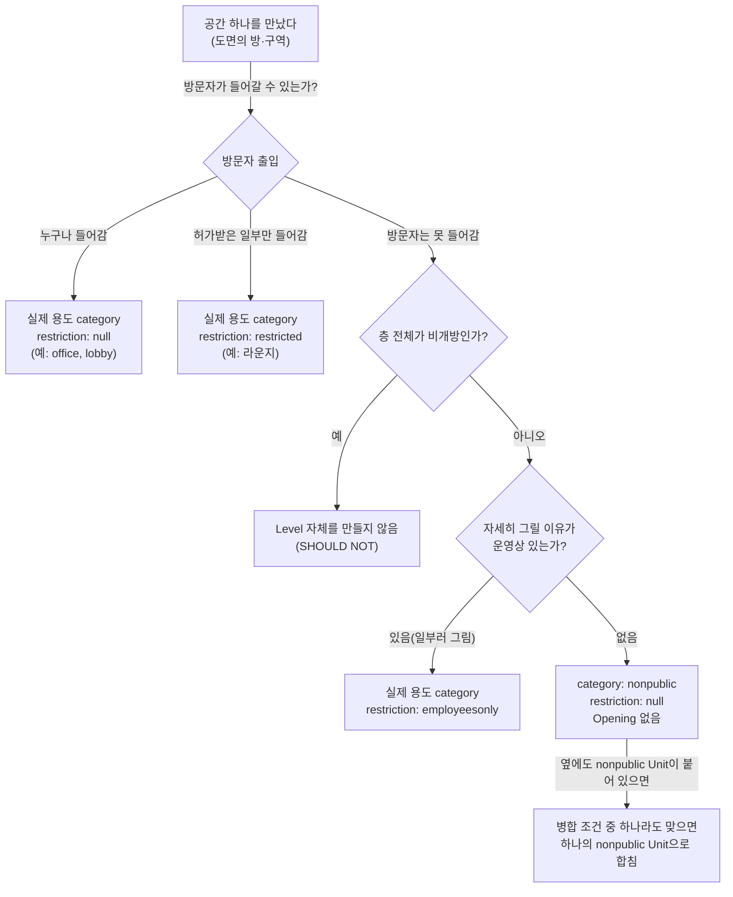

# 15) 비개방 구역은 IMDF에서 어떻게 그리는가 — nonpublic과 restriction

## 요약

실내지도에는 방문자가 들어갈 수 없는 공간이 섞여 있다. 직원 사무실, 탕비실, 창고, 기계실 같은 곳이다. Apple의 실내지도 규격인 IMDF는 이런 공간을 **`category: "nonpublic"`인 Unit 하나**로 그리라고 권장한다. 안쪽에 방이 여러 개 있어도 하나씩 나눠 이름을 붙일 필요가 없다. 맞닿아 있는 비개방 Unit은 조건이 맞으면 오히려 **하나로 합치라고** 권장한다.

이 문서는 다음 순서로 정리한다. 먼저 필요한 낱말을 풀고, 비개방 구역에 적용되는 규칙 다섯 가지와 예외 두 가지를 원문 근거와 함께 설명한다. 그다음 헷갈리기 쉬운 `restriction`(출입 제한) 속성과의 차이를 구분하고, 실제 GeoJSON 예시와 판단 순서도로 마무리한다.

---

## 1. 먼저 알아 둘 낱말

| 낱말 | 쉬운 뜻 | 예시 |
| --- | --- | --- |
| Unit | 한 층 바닥을 나눈 공간 조각 하나. 방·복도·화장실 등이 각각 Unit이다 | 회의실 1개 = Unit 1개 |
| Level | 한 층 전체의 바닥 윤곽 | 3층 |
| `category` | 그 Unit이 **무슨 용도인지** 적는 칸. 정해진 값(열거값) 중에서 고른다 | `office`, `restroom`, `nonpublic` |
| `restriction` | 그 Unit **전체에 출입 제한이 있는지** 적는 칸. 비우거나(null) 정해진 두 값 중 하나를 넣는다 | `null`, `employeesonly`, `restricted` |
| Opening | 공간으로 들어가는 출입구. 지도에서 "여기로 들어갈 수 있다"를 나타낸다 | 매장 입구 |
| 실내조사(survey) | Apple의 Indoor Survey 앱을 들고 건물을 걸어 다니며 위치 신호를 수집하는 작업 | 층마다 걸어 다니며 측정 |
| MUST / SHOULD / MAY | 규칙의 강도. 반드시 / 권장(이유가 있으면 예외 가능) / 해도 됨 | — |

`category`와 `restriction`은 **서로 다른 칸**이라는 점이 이 문서의 핵심이다. `nonpublic`은 `category`에 들어가는 값이고, `employeesonly`·`restricted`는 `restriction`에 들어가는 값이다.

## 2. 비개방 구역 규칙 다섯 가지

모두 OGC IMDF 1.0.0 Unit 페이지의 "nonpublic" 카테고리 규칙과 RESTRICTION 규칙에서 나온 것이다. 원문 전문은 [[src19. IMDF 비개방 구역(nonpublic) 모델링 규칙 조사]]에 있다.

### 2-1. 비개방 구역은 nonpublic Unit으로 그린다 (SHOULD)

> A space that contains non-public areas SHOULD be modeled as a "nonpublic" Unit

"비개방 구역이 **들어 있는** 공간"이라고 쓴 점을 보면, 공간 안의 세부 구성(사무실 몇 개, 창고 몇 개)을 따지지 않고 바깥 윤곽 하나를 `nonpublic`으로 처리하는 것을 전제로 한다.

### 2-2. 맞닿은 nonpublic Unit은 합친다 (SHOULD, 조건부)

같은 층에서 서로 붙어 있는 `nonpublic` Unit은 다음 중 하나에 해당하면 합칠 것을 권장한다.

1. 운영 기관이 따로 나눠 두어서 얻는 업무상 가치가 없을 때
2. 레코드(데이터 한 줄)를 합치면 지도 앱 성능이 나아질 때
3. 합치면 지도가 더 보기 좋아질 때

예를 들어 직원 사무실과 바로 옆 직원 탕비실이 벽 하나를 두고 붙어 있다면, 둘을 나눠 두어도 방문자에게는 쓸모가 없다. 1번 조건에 해당하므로 하나의 `nonpublic` Unit으로 합치는 것이 규격 취지에 맞다.

### 2-3. restriction은 비워 둔다 (SHOULD NOT)

> A "nonpublic" Unit SHOULD NOT possess a restriction

`nonpublic`이라는 카테고리 자체가 이미 "방문자 출입 불가"를 뜻하므로, 출입 제한 칸에 값을 또 넣지 않는다. `restriction`은 `null`로 둔다.

### 2-4. 경계 안에 Opening을 두지 않는다 (SHOULD NOT)

> An Opening SHOULD NOT be within the boundary of a Unit whose category is "nonpublic"

출입구를 그리면 지도에서 "여기로 들어갈 수 있다"로 읽힌다. 방문자가 들어갈 수 없는 곳이므로 출입구를 그리지 않는다.

원문 주석에는 예외처럼 보이는 상황도 적혀 있다. 3차원 건물을 2차원 평면으로 눌러 그리면, 비개방 공간 바로 위나 아래를 지나는 통로의 층간 경계("threshold")가 마치 비개방 공간으로 들어가는 문처럼 겹쳐 보일 수 있다. 이 경우 그것은 비개방 공간의 입구가 아니라 다른 층으로 넘어가는 경계다.

### 2-5. 샤프트·덕트는 반드시 nonpublic이다 (MUST)

> Shafts and ducts MUST be modeled as "nonpublic" Units

건물 설비용 수직 통로(배관 샤프트, 환기 덕트)는 위아래가 뚫려 있어도 `opentobelow`(아래층이 내려다보이는 빈 공간)가 아니라 `nonpublic`으로 그려야 한다. `nonpublic`과 관련된 조항 중 유일하게 강제(MUST)다.

## 3. 예외 두 가지

### 3-1. 층 전체가 비개방이면 Level을 만들지 않는다 (SHOULD NOT)

> An entire floor that is non-public SHOULD NOT be modeled as one or more "nonpublic" Unit. By extension, the floor SHOULD NOT be modeled as a Level

예를 들어 건물 7층 전체가 직원 전용 사무층이라면, 7층 바닥을 `nonpublic` Unit으로 채우는 것이 아니라 **7층이라는 Level 자체를 데이터에 넣지 않는다.** 방문자 지도에 7층이 나타날 이유가 없기 때문이다.

### 3-2. 방문자 응대 공간은 nonpublic에서 빼도 된다 (MAY)

> A space that is non-public which is occupied by Venue personnel that exchange goods/services with a pedestrian MAY be excluded from the "nonpublic" Unit's extent when doing so would improve the map's aesthetic qualities.

매표소 창구 안쪽이나 안내 데스크 뒤처럼 직원만 들어가지만 방문자와 물건·서비스를 주고받는 공간은, 지도가 더 보기 좋아진다면 `nonpublic` 범위에서 빼도 된다. 빼면 그 공간은 앞쪽 매장이나 로비 Unit의 일부로 보이게 된다.

## 4. restriction과 헷갈리지 않기

`restriction` 칸에 들어가는 `employeesonly`라는 값이 이름만 보면 "직원 전용 공간"이라 `nonpublic`과 같은 뜻처럼 보인다. 그러나 쓰는 상황이 다르다.

| 표현 | 쓰는 상황 | 안쪽 방을 나눠 그리는가 | 예시 |
| --- | --- | --- | --- |
| `category: "nonpublic"`, `restriction: null` | 방문자 출입이 불가하고 **지도에 자세히 보여줄 필요가 없는** 구역 | 나누지 않음(하나로) | 직원 사무 구역 전체 |
| 실제 카테고리 + `restriction: "employeesonly"` | 운영 기관이 비개방 구역을 **일부러 자세히** 지도에 넣고 싶을 때 | 나눔(방마다 실제 용도) | 직원용 지도에 회의실·휴게실을 각각 표시 |
| 실제 카테고리 + `restriction: "restricted"` | 방문자 중 **허가받은 일부만** 들어갈 수 있을 때 | 나눔 | 공항 라운지(탑승권 소지자만), 회원 전용 시설 |

원문의 문장 구조가 이 차이를 보여 준다. `employeesonly`는 "운영 기관이 비개방 구역을 **일부러 그리고자 할 때(deliberately wishes to map)**" 쓰라고 되어 있다. 즉 그리지 않기로 했다면 `employeesonly`가 아니라 `nonpublic`이 맞다.

또 하나의 단서 조항이 있다. 평소 운영상 일반 대중이 방문하지 않는 시설(예: 방문객이 정해진 일부뿐인 사옥)에는 `employeesonly`를 쓰지 말라고 권장한다(SHOULD NOT). 이런 시설은 애초에 방문자 기준으로 공간을 구분할 이유가 약하기 때문이다.

## 5. 실내조사가 필요 없는가

결론부터 쓰면, **스펙이 이를 직접 단정하지는 않는다.** 다음 근거로 판단하는 것은 가능하다.

1. Unit 규칙은 "조사가 예정된 공간(a space expected to be surveyed)"이라는 표현을 따로 써서, 조사하지 않는 공간이 있다는 것을 전제한다. 기둥(`column`) Unit도 "조사가 예정된 구역에서만 필요하다"고 적혀 있다.
2. Apple Indoor Maps Program 안내 문서는 "공공 건물 안의 사적 구역(private areas inside public buildings)"의 입점자 정보는 필요 없다고 밝힌다.

두 근거 모두 "비개방 구역은 자세히 측정하거나 기록할 대상이 아니다"라는 방향을 가리킨다. 다만 "`nonpublic` 공간은 조사하지 않아도 된다"는 문장 자체는 확인하지 못했으므로 **확인 필요**로 남긴다.

## 6. GeoJSON 예시

직원 사무 구역을 `nonpublic` Unit 하나로 표현한 예시다. 좌표는 설명용 값이다.

```json
{
  "id": "6c3a1b7e-2f4d-4c1a-9e0b-5d8f7a2c1e90",
  "type": "Feature",
  "feature_type": "unit",
  "geometry": {
    "type": "Polygon",
    "coordinates": [[[129.0001, 36.0001], [129.0004, 36.0001], [129.0004, 36.0003], [129.0001, 36.0003], [129.0001, 36.0001]]]
  },
  "properties": {
    "category": "nonpublic",
    "restriction": null,
    "accessibility": null,
    "name": null,
    "alt_name": null,
    "display_point": null,
    "level_id": "a1b2c3d4-0000-4000-8000-000000000003"
  }
}
```

```json
{
// 중괄호 하나가 Feature(지도 요소) 하나다.
  "id": "6c3a1b7e-2f4d-4c1a-9e0b-5d8f7a2c1e90",
// 이 Unit의 고유 번호(UUID). 다른 요소와 겹치지 않는 임의의 긴 문자열이다.
  "type": "Feature",
// GeoJSON 형식에서 "이것은 지도 요소 하나"라고 알리는 고정 표기다.
  "feature_type": "unit",
// IMDF에서 이 요소가 Unit(공간 조각)이라는 뜻이다.
  "geometry": {
// 이 Unit이 지도 위에서 차지하는 모양을 적는 부분이 시작된다.
    "type": "Polygon",
// 모양의 종류는 다각형(면)이다.
    "coordinates": [[[129.0001, 36.0001], [129.0004, 36.0001], [129.0004, 36.0003], [129.0001, 36.0003], [129.0001, 36.0001]]]
// 다각형 꼭짓점들의 [경도, 위도] 목록이다. 첫 점과 마지막 점이 같아야 다각형이 닫힌다. 안쪽 방들의 벽은 그리지 않고 바깥 윤곽만 적는다.
  },
// 모양 정보가 끝난다.
  "properties": {
// 이 Unit의 속성(설명 정보)이 시작된다.
    "category": "nonpublic",
// 용도 칸. "방문자 출입 불가 구역"이라는 뜻의 nonpublic을 넣는다.
    "restriction": null,
// 출입 제한 칸. nonpublic이면 비워 둔다(null = 값 없음).
    "accessibility": null,
// 휠체어 접근성 등 정보 칸. 방문자가 쓰지 않는 공간이라 비워 둔다.
    "name": null,
// 지도에 표시할 이름 칸. 비개방 구역에는 이름을 붙이지 않았다.
    "alt_name": null,
// 보조 이름 칸. 비워 둔다.
    "display_point": null,
// 이름표를 놓을 위치 칸. 이름이 없으니 비워 둔다.
    "level_id": "a1b2c3d4-0000-4000-8000-000000000003"
// 이 Unit이 속한 층(Level)의 고유 번호다.
  }
// 속성 정보가 끝난다.
}
// Feature 하나가 끝난다.
```

`name`·`display_point`를 비운 것은 이 예시의 선택이다. 스펙이 `nonpublic` Unit의 이름을 금지하지는 않는다.



- **A** 도면에서 공간 하나를 골라 어떻게 표현할지 정하는 출발점이다.
- **B** 방문자 출입 가능 여부로 세 갈래로 나눈다.
- **C·D** 방문자가 들어가는 공간은 실제 용도를 카테고리로 쓰고, 일부만 들어가면 `restricted`를 붙인다.
- **E·F** 층 전체가 비개방이면 그 층을 데이터에 넣지 않는다.
- **G·H** 운영 기관이 비개방 구역을 일부러 지도에 넣고 싶을 때만 방마다 나눠 그리고 `employeesonly`를 붙인다.
- **I·J** 그 외 비개방 구역은 `nonpublic` 하나로 그리고, 붙어 있는 것끼리는 조건이 맞으면 합친다.

## 7. IM-DFrnt에서의 적용

- Unit 카테고리 선택지에 `nonpublic`이 이미 있다(`Model/PropertySchema.swift:247`). 비개방 구역 바깥 윤곽을 Unit 하나로 묶고 카테고리로 `nonpublic`을 고르면 된다.
- 앱의 `restriction`은 항상 `null`로 내보낸다. `nonpublic` Unit에는 2-3 규칙에 따라 원래 비워 두므로 충돌이 없다. `employeesonly`·`restricted`가 필요해지는 경우(4절)에만 입력 수단이 부족하다([[src15. IMDF Section·Geofence properties 전수 대조와 카테고리 열거형 조사]]의 "불일치" 항목).

## 관련 링크

- [[nonpublic]] — 개념어 문서
- [[RESTRICTION-CATEGORY]] — `employeesonly`·`restricted`
- [[UNIT-CATEGORY]] — `nonpublic`이 속한 열거형
- [[08) IMDF Feature Type·카테고리 전체 레퍼런스]] — 열거형 전량
- [[07) 도면의 방·문·창이 IMDF 좌표가 되는 기준]] — 도면 선분이 Unit 경계가 되는 기준

## 미해결 질문

- `nonpublic` 공간을 Indoor Survey로 조사하지 않아도 된다고 명시한 Apple 문서가 있는가(5절은 추론).
- 스펙의 "Illustration"(Unit Illustrative Guidance) 그림으로 병합·제외 예시의 실제 모양을 확인해야 한다.
- `nonpublic` Unit에 둘러싸인 엘리베이터·계단 Unit으로 들어가는 출입구는 어떻게 그리는가. 스펙은 수직 이동 Unit이 `nonpublic`에 둘러싸이는 것을 허용(MAY)하지만, `nonpublic` 경계 안 Opening은 권장하지 않는다(SHOULD NOT).
