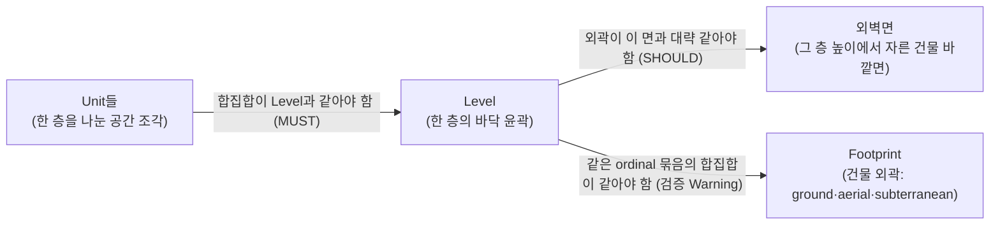
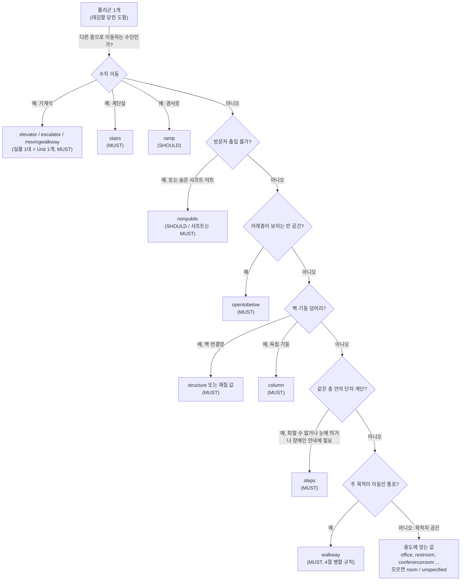
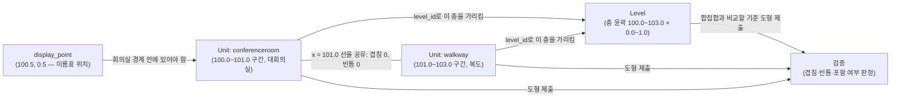

# 16) Unit 레이어 태깅 규칙 — 무엇을 한 Unit으로 자르고 어떤 category를 붙이는가

## 요약

IMDFrnt에서 "Unit 태깅"은 도면의 닫힌 폴리곤 하나를 Unit Feature로 지정하고 `category`·`name` 같은 속성을 채우는 작업이다. IMDF 1.0.0 스펙은 이 작업에 세 종류의 규칙을 둔다.

1. **경계 규칙** — 한 층(Level)은 Unit들로 빈틈도 겹침도 없이 채워야 한다. 기준선은 Footprint가 아니라 그 층 높이의 외벽면을 따르는 Level 외곽이며, 외벽 두께도 어떤 Unit이든 덮어야 한다. 벽은 선 하나로 단순화하거나, 따로 그릴 경우 `structure`·`column` Unit으로 만든다.
2. **category 규칙** — 엘리베이터·계단 같은 수직 이동 수단, 비개방 구역, 통로(`walkway`)에는 각각 "이럴 때는 반드시 이 값"이라는 조항이 있다. 그 밖의 공간은 용도에 맞는 값을 고른다.
3. **속성 규칙** — `category`와 `level_id`만 필수다. `name`은 형식을 일관되게 쓰고 호수(주소) 정보를 넣지 않는다. `display_point`는 Unit 안에 있어야 한다.

이 문서는 낱말 → 경계(Level·Footprint·외벽 포함) → category 판단 순서 → 통로 병합 → 속성 → 검증 → 예시 → IMDFrnt 적용 순으로 정리한다. 원문 전문은 [[src20. IMDF Unit 태깅 규칙 원문 조사 — Property·Geometry·Category Specific Rules·Validations]]에 있다.

---

## 1. 먼저 알아 둘 낱말

| 낱말 | 뜻 | 예시 |
| --- | --- | --- |
| 태깅 | IMDFrnt에서 도면 개체를 하나의 Feature Type으로 지정하고 속성 값을 채우는 작업 | 방 폴리곤을 Unit으로 지정하고 `category: "office"` 입력 |
| Unit | 한 층 바닥을 나눈 공간 조각 하나. 방·복도·계단·벽 덩어리까지 모두 Unit이다 | 회의실 1개 = Unit 1개 |
| Level | 한 층 전체의 바닥 윤곽. Unit들이 빈틈없이 덮어야 하는 기준 도형이다. 외곽은 그 층 높이의 외벽면을 따른다 | 3층 |
| Footprint | 건물 외곽 도형. `ground`(지상 범위)·`aerial`(위에서 본 그림자)·`subterranean`(지하 범위) 세 종류가 있고, 같은 ordinal 묶음의 Level 합집합과 비교된다 | 1층 Level 합집합 = `ground` Footprint |
| `category` | Unit의 용도를 정해진 값 목록([[UNIT-CATEGORY]]) 중에서 고른 것. 필수 | `room`, `walkway`, `stairs` |
| `level_id` | 이 Unit이 어느 Level에 속하는지 가리키는 id. 필수 | 3층 Level의 UUID |
| [[대칭차]] (symmetrical difference) | 두 도형 A, B에서 "A에만 있거나 B에만 있는 부분". 대칭차가 없다는 것은 두 도형이 정확히 같다는 뜻. IMDF에서 "Unit 사이 대칭차"는 Unit 사이의 빈틈을 가리킨다 | Unit 합집합과 Level 사이 대칭차 = 빈틈 + 삐져나간 부분 |
| Opening | 공간으로 들어가는 출입구를 나타내는 선분(LineString) | 회의실 문 |
| ordinal | Level의 층 번호(정수). 0이 지상층 | 1층 = 0, 2층 = 1 |
| 실내조사(survey) | Apple Indoor Survey 앱으로 건물을 걸으며 위치 신호를 수집하는 작업. 블루닷(현재 위치 점)의 정확도가 여기서 나온다 | — |
| MUST / SHOULD / MAY | 규칙의 강도. 반드시 / 권장(이유가 있으면 예외 가능) / 해도 됨 | — |

## 2. 경계 규칙 — 층을 어떻게 나누는가

### 2-1. 층은 Unit으로 빈틈·겹침 없이 채운다 (MUST NOT 대칭차)

> Symmetrical difference MUST NOT exist:
> - Among Units that reference the same Level
> - Between the union of Units and their referenced Level

두 번째 줄은 "같은 층 Unit을 모두 합친 도형이 그 Level 도형과 정확히 같아야 한다"는 뜻이다. 대칭차가 생기는 경우는 두 가지뿐이다.

- **빈틈:** Level 안인데 어떤 Unit도 덮지 않은 부분. 예: 방과 복도 사이 벽 두께만큼의 띠가 비어 있음.
- **삐져나감:** Unit이 Level 바깥으로 나간 부분. 예: 도면 오류로 그려진 외벽 밖 선이 Unit에 포함됨.

첫 번째 줄(Unit끼리 대칭차 없음)은 **Unit 사이에 빈틈을 두지 말라**는 뜻이다. (2026-10-18 정정: 처음에는 이 줄을 "겹침 금지"로 해석했으나, OGC Glossary 원문으로 확인한 결과 빈틈 금지다.)

> Simplification is the process of reducing a physical, vertical barrier, of variable cross-sectional depth, to a boundary that is shared by Units. In other words, symmetrical difference does not exist among Units that reference the same Level.
>
> Unintentional symmetrical difference is the consequence of the poor "snapping" of vertices among features in or among different layers.
> Intentional symmetrical difference is a legacy map production approach. It was used to imply the existence of a physical, vertical barrier.

- **의도하지 않은 대칭차:** 이웃 Feature의 꼭짓점이 정확히 맞물리지 않아(스냅 불량) 생긴 가는 틈.
- **의도한 대칭차:** 예전 지도 제작 방식. 방과 방 사이를 벽 두께만큼 비워 두어 "여기에 벽이 있다"를 암시했다. IMDF는 이것을 금지한다. 벽을 표현하려면 단순화해서 경계를 공유하거나(2-3절), `structure` Unit으로 따로 그린다(2-4절).

겹침 금지는 이 조항이 아니라 검증 항목 `UnitsMustNotOverlap`("Unit interiors do not intersect", Warning)과 WWDC19의 "In IMDF, units should never overlap"이 다룬다.

두 규칙을 합치면 결론은 하나다. **Unit들은 Level을 퍼즐처럼 정확히 나눈 조각이어야 한다.** 그래서 사람이 들어갈 수 없는 벽 자리, 기둥 자리, 계단 아래 빈 공간도 어떤 Unit으로든 채워진다. 이것이 UNIT-CATEGORY에 `structure`·`column`·`opentobelow` 같은 "공간이 아닌" 값이 있는 이유다.

이웃한 Unit은 경계선을 **공유**해야 한다(Glossary의 단순화 정의: "a boundary that is shared by Units"). 꼭짓점이 1mm라도 어긋나면 빈틈이나 겹침이 생긴다. 도면 선을 닫는 허용 오차는 [[12) 도면을 폴리곤으로 닫는 허용 오차 — 절대 치수인가 비례값인가]]에서 다뤘다.

### 2-2. 덮어야 할 경계는 Level 외곽이다 — Footprint·외벽과의 관계

2-1의 "층"은 Footprint가 아니라 **각 Unit이 `level_id`로 가리키는 Level 도형**이다. 세 Feature의 관계는 아래처럼 단계별로 정해진다.



| 노드 | 의미 |
| --- | --- |
| Unit들 | 태깅하는 방·복도·벽 덩어리 등 |
| Level | 층 하나의 도형. Unit이 덮어야 하는 기준 |
| 외벽면 | Level 외곽이 따라야 하는 실제 건물 면 |
| Footprint | 여러 층 Level을 합친 결과와 비교되는 건물 외곽 |

| 화살표 | 의미 |
| --- | --- |
| Unit → Level | Unit 합집합과 Level 사이 대칭차 금지. 빈틈·삐져나감이 없어야 한다 |
| Level → 외벽면 | Level 외곽을 그 층 높이의 외벽면에 맞춘다 |
| Level → Footprint | Level 하나가 아니라 ordinal 묶음의 합집합을 Footprint와 비교한다 |

#### (1) Level 외곽은 그 층 높이의 외벽면 (SHOULD)

> The Level SHOULD possess an extent that is analogous to the surface (facade) of the physical building at the height where the modeled floor is positioned.

층을 그 높이에서 수평으로 잘랐을 때 보이는 건물 바깥면이 Level 외곽이다. 위층이 안으로 들어가거나(셋백) 밖으로 튀어나온 건물은 층마다 Level 외곽이 다르다.

같은 Building·같은 ordinal의 Level끼리는 겹치거나 서로 안에 들어가면 안 된다(MUST NOT). 외벽면이 같은 층들은 Level 도형도 같아야 하고(MUST), 기술적으로 불가능하면 1:500 축척에서 눈에 띄지 않는 차이, 즉 단면 방향 0.2m까지 허용한다.

#### (2) Level과 Footprint는 묶음 단위로 비교한다

| Footprint category | 원문 정의 | 같아야 하는 Level 묶음 (Validations, 모두 Warning) |
| --- | --- | --- |
| `ground` | 지상 높이에서 건물의 물리적 범위 | ordinal 0인 실내 Level들의 합집합 |
| `aerial` | 머리 위 무한히 먼 광원이 아래로 드리운 건물 그림자 | ordinal 0 이상인 실내 Level들의 합집합 |
| `subterranean` | 지하 모든 층 범위의 최대치 | ordinal −1 이하 Level들의 합집합 |

#### (3) Level과 Footprint가 완전히 일치해도 되는가

**된다. 1층은 오히려 일치하는 것이 검증 기준이다.** `IndoorLevelNotEqualToGroundFootprint`는 ordinal 0 실내 Level들의 합집합이 `ground` Footprint와 같은지 검사한다. 건물 하나에 ordinal 0 Level이 하나뿐이면 그 Level 도형과 `ground` Footprint는 같은 도형이 된다. 위아래 외벽이 수직으로 곧은 건물이라면 모든 지상층 Level이 `aerial` Footprint와도 같아진다.

일치하지 않는 것이 정상인 경우:

| 경우 | 이유 |
| --- | --- |
| 위층 외곽이 1층과 다름(셋백·돌출) | Level은 각 층 외벽면을 따르고, `aerial`은 모든 지상층을 합친 그림자다. 위층 Level 하나가 `aerial`보다 작은 것은 정상이다 |
| 같은 ordinal에 Level이 여럿 | 일치 대상은 Level 하나가 아니라 합집합이다 |
| 경사 지형이라 여러 층이 지면에 닿음 | `ground`는 지면에 노출된 모든 층의 부분을 합친 것이다(MUST). ordinal 0만으로는 같지 않을 수 있다 |
| 실외 Level(`outdoor: true`) | 검증 대상은 "Indoor Levels"다. 실외 Level은 비교에서 빠진다 |
| 공유 건물 안 시설 | Footprint에는 기능상 무관하지만 구조상 떼어낼 수 없는 공간도 포함할 것을 권장한다(SHOULD). 이 경우 Footprint가 Level 합집합보다 커질 수 있다(검증 경고와의 관계는 확인 필요) |

#### (4) 외벽도 Unit인가

반드시 그렇지는 않다. 다만 **외벽 두께가 차지하는 자리는 어떤 Unit이든 반드시 덮어야 한다.** Level 외곽이 외벽 바깥면이면 외벽 두께는 Level 안에 들어가고, Unit 합집합 = Level(MUST) 규칙 때문에 그 자리를 비워 둘 수 없다.

| 방법 | 외벽이 Unit인가 | 근거 |
| --- | --- | --- |
| ① 단순화 (기본) | 아니다. 안쪽 방·복도 Unit의 경계를 Level 외곽까지 넓혀 외벽 두께를 그 Unit에 포함한다 | 벽 단순화(SHOULD), 경계는 벽 중심선 또는 벽 면을 따라도 됨(MAY) — 2-3절 |
| ② 별도 도형 | 그렇다. `structure` Unit, 재질을 밝히려면 `concrete`·`glass` 등 | 건축적으로 중요한 벽은 따로 그려도 되고(MAY), 이때 바닥-천장 벽 연결망은 `structure`(MUST) — 2-4절 |

①에서 주의할 점: 내벽은 중심선을 따라 양쪽 방이 두께를 반씩 나눠 가질 수 있지만, 외벽 바깥쪽에는 Unit이 없다. 외벽 중심선에서 경계를 멈추면 바깥 절반이 빈틈으로 남는다. 외벽 두께는 안쪽 Unit이 전부 가져가야 한다.

②를 고를 만한 경우는 유리 커튼월처럼 외관상 두드러지는 벽, 실내조사 때 기준 지형지물로 쓸 두꺼운 벽이다. 원문이 "a network of floor-to-ceiling walls"(벽 연결망)라고 쓰므로, 벽을 따로 그리기로 했다면 외벽만이 아니라 연결된 벽 구조 전체를 `structure`로 그리는 것이 원문 취지에 맞다.

**원문과 해석의 구분:** 스펙에는 "외벽"을 따로 다룬 조항이 없다. (4)는 Level 외곽 = 외벽면 조항, Unit 합집합 = Level 조항, 벽 일반의 단순화·`structure` 조항을 조합한 해석이다. Level 외곽의 위치는 Unit Illustrative Guidance 그림으로 확인했다(2026-10-18). 그림 `UnitBoundaries.png`는 벽 면 방식(왼쪽)과 중심선 방식(오른쪽)을 나란히 보여 주며, 주석은 "Note In both cases, the Level extent is "...analogous to the surface (facade) of the physical building at the height where the modeled floor is positioned."" 이다. 두 그림 모두 가장 바깥 경계선이 외벽 띠의 바깥쪽 가장자리에 그어져 있고, 외벽 두께는 안쪽 방 Unit의 경계 안에 들어가 있다. 즉 **Level 외곽 = 외벽 바깥면, 단순화 시 외벽 두께는 안쪽 Unit이 가진다**는 ①의 설명이 그림과 일치한다. 그림에 대한 판독은 이 위키의 해석이다.

#### 실무 순서

1. 층마다 Level 외곽을 그 층의 외벽 바깥면으로 확정한다.
2. 그 안을 Unit으로 빈틈·겹침 없이 나눈다. 외벽 두께는 안쪽 Unit에 포함하거나 `structure`로 따로 그린다.
3. 같은 ordinal 묶음의 Level 합집합이 해당 Footprint와 같은지 확인한다.

### 2-3. 벽은 단순화한다 (SHOULD), 복잡한 곳은 반드시 (MUST)

벽은 두께가 있다. 단순화란 이 두께를 없애고 경계선 하나로 만드는 것이다. 선을 어디에 둘지는 두 가지가 허용된다.

| 방식 | 강도 | 결과 |
| --- | --- | --- |
| 벽 두께의 중심선 | MAY | 양쪽 방이 벽 두께를 반씩 나눠 가진다. 빈틈이 생기지 않는다 |
| 도면의 벽 면(한쪽 선) | MAY | 한쪽 방이 벽 두께를 모두 가진다. 어느 쪽 면을 고르느냐에 따라 방 면적이 달라진다 |

스펙 주석은 "방 내부 면적이 과도하게 달라지지 않도록 선을 고르라"고 한다. 벽이 여러 개 교차하는 곳, 벽과 기둥이 붙은 곳은 반드시 단순화한다(MUST).

### 2-4. 벽을 따로 그릴 때는 structure·column (MUST)

외관이나 크기 때문에 건축적으로 중요한 벽은 단순화하지 않고 별도 도형으로 그려도 된다(MAY). 이때 규칙은 다음과 같다.

| 대상 | category | 강도 |
| --- | --- | --- |
| 바닥-천장 벽의 연결망, 벽·기둥 일체 구조 | `structure` | MUST |
| 위와 같으나 재질을 밝히고 싶을 때 | `brick`, `concrete`, `drywall`, `glass`, `wood` | may (소문자, 선택) |
| 바닥-천장 독립 기둥 | `column` | MUST |
| 벽에 붙은 기둥 (벽을 따로 그리는 경우) | `structure` (`column` 아님) | MUST |
| `column`의 면적 | 0.09㎡ 초과 (약 30cm × 30cm보다 큼) | SHOULD |

`column` 조항에는 "기둥은 실내조사 때 방향을 잡는 기준점 역할을 하므로, 대체로 실내조사 예정 구역에서만 필요하다"는 주석이 붙는다. 실내조사를 하지 않는 구역의 기둥은 단순화해 주변 Unit에 포함시켜도 된다는 판단의 근거가 된다.

이 조항으로 [[UNIT-CATEGORY]] 문서에 "확인 필요"로 남아 있던 질문, 즉 재질 값의 용법이 해소된다. 재질 값은 **`structure`를 재질별로 구체화한 값**이다.

#### 벽 Unit은 어떤 단위로 나누는가 — 큰 덩어리인가, 구역별 조각인가

스펙에는 "벽 Unit을 하나로 할지 나눌지"를 직접 정한 조항이 없다. 아래는 원문 표현·그림·검증 항목에서 끌어낸 판단이다.

**원문이 쓰는 단위는 "벽의 연결망 하나"다.**

> A network of floor-to-ceiling walls or an integrated system of walls and columns MUST be modeled as a "structure" Unit.

Glossary의 `structure` 정의도 같다.

> "structure" models the presence and physical extent of a network of floor-to-ceiling walls or an integrated system of walls and columns.
> Illustration: Walls and structurally integrated columns are captured as "structure" to model the physical extent of a network of floor-to-ceiling barriers.

벽 한 토막이나 방 하나 둘레가 아니라, 서로 이어진 벽 전체(network)를 "a Unit"으로 표현한다고 쓴다. 벽에 붙은 기둥도 그 안에 포함된다.

**Glossary 그림에서는 층 전체 벽이 한 덩어리로 칠해져 있다.** `structure` 항목의 그림(`Sym_Difference.png`)은 외벽과 내벽 전체를 같은 색 하나로 "Venue's Structure"로 표시한다. 외벽도 이 덩어리에 포함되고, 벽에 붙은 작은 기둥 돌출부도 벽과 한 몸이다. **문 자리마다 벽이 끊겨 있으므로** 덩어리라 해도 실제 도형은 서로 떨어진 여러 조각이다. 그림에 Feature 경계 표시가 없어 Unit이 1개인지 여러 개인지는 그림만으로 확정할 수 없다.

**떨어진 조각은 MultiPolygon으로 묶을 수 있다.** `UnitMustHavePolygonalGeometry`는 "Polygon or MultiPolygon"을 허용한다. Microsoft Places의 IMDF 요구사항도 `unit.geojson`에 "Polygon, multipolygon"을 허용하고 "Walls are also represented with closed polygon shapes"라고 쓴다.

| 방식 | 스펙과의 관계 | 판단 |
| --- | --- | --- |
| 층 하나의 벽 전체를 Unit 1개로 (MultiPolygon) | 위반 없음. 원문의 "a network … a Unit"에 가장 가까움 | 기본 권장 |
| 서로 이어진 조각마다 Unit 1개 (Polygon 여러 개) | 위반 없음. 끊긴 조각 각각을 하나의 연결망으로 보는 해석 | 허용 |
| 방·구역마다 벽을 잘라 Unit 여러 개 | 직접 금지 조항은 없음. 이어진 벽을 임의로 끊는 것이라 "연결망 하나 = Unit 하나" 취지와 어긋남 | 비권장 |
| 재질이 바뀌는 곳에서 나누기 | Unit의 category는 하나뿐이므로 `concrete`·`glass` 같은 재질 값을 쓰면 재질별로 나눌 수밖에 없음 | 재질 값을 쓸 때 필수 |
| 층마다 나누기 | Unit의 `level_id`는 하나뿐 | 필수 |

"비권장" 판단에는 해석이 섞여 있다. `nonpublic`·`walkway`에는 "맞닿은 Unit은 따로 둘 가치가 없으면 합친다(SHOULD)"는 조항이 있고, 그 이유로 레코드 병합에 따른 앱 성능 향상을 든다. `structure`에는 이런 병합 조항이 없지만, 같은 원리로 보면 쪼갤 이유가 없다.

어느 방식이든 지킬 조건:

- 벽 Unit과 방·복도 Unit은 겹치지 않고, 이 둘의 합집합이 Level과 같아야 한다. 벽 Unit 경계와 방 Unit 경계가 같은 벽 면 좌표를 공유해야 한다.
- 일부 벽만 따로 그려도 된다. "architecturally significant … MAY be modeled as explicit geometries instead of being simplified"는 벽 단위의 선택이다. 나머지 벽은 단순화해 방 Unit에 포함한다.
- 문 자리에서는 벽이 끊기고 방 Unit과 복도 Unit이 직접 맞닿는다. Opening은 그 경계 위에 놓인다(2-6절).
- 벽 Unit 안에는 Amenity·Anchor를 두지 않는다(`StructuralUnitMustNotContainAmenity`·`StructuralUnitMustNotContainAnchor`, Warning).

### 2-5. 실내조사 구역의 경계를 임의로 긋지 않는다 (MUST NOT)

> A Unit that models a space expected to be surveyed MUST NOT possess a boundary whose spatial location is arbitrary and effect an outcome where the "blue dot" position is unrealistic.

실내조사로 블루닷을 띄울 공간은 실제 벽 위치에 맞춰 그려야 한다. 임의로 그은 경계 때문에 블루닷이 벽 너머 방에 찍히는 일이 없어야 한다는 뜻이다.

### 2-6. Opening은 Unit 경계 위에 놓인다 (MUST)

> An Opening MUST be covered by a Unit boundary where the modeled entrance exists

출입구 선분은 Unit 경계선과 겹쳐야 한다. 실제 도면에서는 문 자리의 벽이 끊겨 있어 방 폴리곤이 열려 있으므로, 문 선분으로 링을 닫으면 이 조건이 자동으로 맞는다. IMDFrnt가 Opening을 다른 type보다 먼저 태깅하게 하는 이유가 이것이다(8절).

## 3. category 판단 순서

한 폴리곤에 category를 붙일 때, "반드시"가 걸린 값부터 확인하면 판단이 빨라진다. 아래 순서는 스펙 조항의 강도를 기준으로 이 위키가 정리한 것이다(스펙이 순서를 정해 준 것은 아니다).



| 노드 | 의미 |
| --- | --- |
| 폴리곤 1개 | 태깅 대상인 닫힌 도형 하나 |
| 수직 이동 | 이 공간이 다른 Level로 사람을 옮기는가를 묻는 분기 |
| elevator / escalator / movingwalkway | 기계식 이동 수단. 실물 하나당 Unit 하나 |
| stairs | 다른 Level로 이어지는 계단실 |
| ramp | 다른 Level로 이어지는 경사로 |
| 방문자 출입 불가? | 직원 구역·기계실 등 일반 방문자가 못 들어가는가 |
| nonpublic | 비개방 구역. 안쪽 방을 나누지 않고 하나로 그림([[15) 비개방 구역은 IMDF에서 어떻게 그리는가 — nonpublic과 restriction]]) |
| opentobelow | 아트리움처럼 아래층이 보이는 수직 빈 공간 |
| structure / column | 벽 덩어리, 독립 기둥 |
| steps | 같은 층 안에서 오르내리는 몇 단짜리 계단 |
| walkway | 이동을 위해 설계된 통로 |
| 용도에 맞는 값 | 위 어디에도 해당하지 않는 목적지 공간 |

| 화살표 | 의미 |
| --- | --- |
| 폴리곤 → 수직 이동 | 가장 강한 규칙(MUST)이 걸린 수직 이동 여부를 먼저 묻는다 |
| 수직 이동 → 각 값 | 이동 방식에 따라 값이 정해진다 |
| "아니오" 화살표들 | 해당 조건이 아니면 다음 조건으로 넘어간다 |
| "예" 화살표들 | 해당 조건이면 그 값으로 확정하고 판단을 끝낸다 |

### 3-1. 수직 이동 수단의 추가 규칙

| category | 핵심 규칙 | 강도 |
| --- | --- | --- |
| `elevator` | 엘리베이터 뱅크 안 칸마다 Unit 하나 | MUST |
| `elevator` | 같은 엘리베이터는 모든 층에서 같은 도형. 불가능하면 어긋남 10% 미만. 어긋남은 경사형 엘리베이터만 허용 | MUST |
| `escalator` | 에스컬레이터마다 Unit 하나. 나란한 에스컬레이터 Unit끼리 맞닿음 | MUST |
| `escalator` | ordinal 1 차이 나는 두 층: 서로 맞닿고, 진행 방향으로 정렬하며, 각각 실물 길이의 약 절반만 그림. 안 되면 겹침·10% 이하 옆 어긋남 허용 | SHOULD |
| `escalator` | ordinal 2 이상 차이: 완전 정렬(안 되면 10% 이하 어긋남 MAY) | MUST |
| `escalator` | 층 사이 공중 구간은 그리지 않음. 도면에서 다른 그릴 대상을 덮으면 범위를 줄임 | SHOULD NOT / SHOULD |
| `movingwalkway` | 무빙워크마다 Unit 하나, 인접한 것끼리 맞닿음 | MUST |
| `stairs` | 다른 층으로 가는 계단실은 `stairs` | MUST |
| `stairs` | 계단실을 관통하는 빈 공간은 `stairs`에 포함(아니면 `opentobelow`로 분리 MAY) | SHOULD |
| `ramp` | 다른 층으로 가는 경사로는 `ramp` | SHOULD |
| `ramp` | 같은 층 경사로는 계단·엘리베이터의 대안일 때만 `ramp`, 아니면 `walkway` | MAY / MUST |
| `ramp` | 경사로와 계단 단이 일체 구조면 전체를 `ramp` | SHOULD |
| `steps` | 같은 층 단차 계단: 피할 수 없음 / 건축적으로 눈에 띔 / 장애가 있는 보행자의 장애물 인지에 도움 중 하나면 `steps` | MUST |

에스컬레이터 "절반 규칙"의 이유: 1층과 2층을 잇는 에스컬레이터는 실물이 하나지만 두 Level에 각각 Unit이 있어야 한다. 1층 Unit은 아래쪽 절반, 2층 Unit은 위쪽 절반을 그려 서로 맞닿게 하면, 두 층을 겹쳐 봤을 때 실물 하나의 길이와 같아진다.

`stairs`와 `steps`의 구분 기준은 Level이다. 다른 Level로 가면 `stairs`, 같은 Level 안의 단차면 `steps`다.

## 4. walkway — 통로를 나누고 합치는 기준

`walkway`는 "보행자의 이동을 돕도록 설계된 통로"다(MUST). 통로는 여러 폴리곤으로 쪼개져 그려지기 쉬워서 병합 규칙이 따로 있다.

| 상황 | 처리 | 강도 |
| --- | --- | --- |
| 같은 층에서 맞닿은 walkway의 물리적 특성 차이가 없음 | 병합 | SHOULD |
| 맞닿는 자리에 문·장벽이 없음 | 병합 | SHOULD |
| 문은 있지만 Opening으로 그려도 얻는 것이 없음 | 병합 | SHOULD |
| 출입이 통제되는 문이 있음 | 병합하지 않음 | SHOULD NOT |
| 통로 옆에 서비스(키오스크 등)가 있지만 주 목적은 이동 | `walkway` 유지 | SHOULD |
| 목적지이자 통로인 구역, 물리적 장벽으로 나뉘고 기능 차이 뚜렷 | `room` | SHOULD |
| 목적지이자 통로인 구역, 장벽 없이 이어짐 | `walkway` | SHOULD |
| 목적지도 통로도 추론 불가(전시장·컨벤션 센터처럼 용도가 수시로 바뀜) | `walkway` | SHOULD |

병합 조항에는 단서가 붙는다. 통로 전체를 Unit 하나로 그리면 보행자가 지도에서 자기 위치를 가늠하기 어려워질 수 있으니, 지도 앱 사용 경험을 고려해 판단하라는 것이다. 예를 들어 건물 전체를 관통하는 긴 복도는 방화문 자리에서 나눠 두는 편이 위치 파악에 낫다.

## 5. 속성 채우기

| property | 필수 | 규칙 | 강도 |
| --- | --- | --- | --- |
| `category` | 예 | UNIT-CATEGORY 값 중 하나. 3절 순서로 판단 | MUST |
| `level_id` | 예 | 이 Unit이 속한 Level의 id. Unit은 그 Level 안에 있어야 함 | MUST |
| `name` | 아니오(null 가능) | 레이어 전체·모든 납품본에서 형식 일관. 다른 레이어 내용 중복 금지. 호수 같은 주소 정보 넣지 않음 | MUST / SHOULD NOT / SHOULD NOT |
| `alt_name` | 아니오 | name과 같은 규칙. alt_name만 있고 name이 없으면 경고 | SHOULD NOT, Warning |
| `restriction` | 아니오 | 일부 방문자만 들어가는 공간에 `restricted`, 비개방 구역을 일부러 자세히 그릴 때 `employeesonly`. `nonpublic` Unit에는 넣지 않음 | SHOULD / SHOULD NOT |
| `accessibility` | 아니오 | 장애가 있는 보행자를 위한 접근성 값 배열 | — |
| `display_point` | 아니오 | Unit 대표점. Unit 경계 안에 있어야 함. 맞닿은 같은 category Unit 묶음의 대표점으로도 쓸 수 있음 | MAY / MUST |

`name`의 주소 정보 규칙은 실무에서 자주 걸린다. "301호"를 Unit name에 넣지 말고, Address Feature의 `unit` 필드에 "301"을 넣은 뒤 그 Unit 안에 Anchor를 찍어 Address를 참조하라는 것이 스펙 권장이다(SHOULD). 방 이름이 우연히 호수와 같을 때만 예외다(MAY).

`display_point`의 "맞닿은 같은 category Unit 묶음" 조항은, 예를 들어 엘리베이터 세 칸이 붙어 있을 때 아이콘을 칸마다 세 개 찍지 않고 한 칸의 `display_point`로 묶음 전체를 대표하는 용도로 읽힌다(Illustration 링크가 Glossary의 `elevator-unit`을 가리킴, 그림 미확인).

## 6. 검증 — 어떤 실수가 막히는가

OGC Validations 표에서 Unit 태깅과 직접 관련된 항목만 추렸다. Violation은 규격 위반, Warning은 경고다.

| 실수 | 검증 항목 | severity |
| --- | --- | --- |
| category를 비워 둠 | UnitMustHaveCategory | Violation |
| 목록에 없는 category 값 | UnitCategoryMustBeValid | Violation |
| level_id 없음 | UnitMustReferenceLevel | Violation |
| Unit이 Level 밖으로 나감 | UnitMustBeCoveredByReferencedLevel | Violation |
| geometry가 Polygon·MultiPolygon이 아님 | UnitMustHavePolygonalGeometry | Violation |
| id가 UUID v4가 아님 | InvalidFeatureID | Violation |
| 층에 Unit이 하나도 없음 | LevelMustBeReferencedByUnit | Violation |
| Unit끼리 내부가 겹침 | UnitsMustNotOverlap | Warning |
| Unit 합집합이 Level과 다름(빈틈) | LevelMustBeFullyCoveredByUnits | Warning |
| display_point가 Unit 밖 | UnitGeometryMustContainDisplayPoint | Warning |
| Opening이 Unit 경계 위에 없음 | OpeningMustBeCoveredByUnitBoundary | Warning |
| alt_name만 있고 name 없음 | HasOnlyAltName | Warning |
| `opentobelow`·구조체 Unit 안에 Amenity·Anchor | OpenToBelowUnitMustNotContain…, StructuralUnitMustNotContain… | Warning |

주의할 점: OGC 표는 Unit 겹침과 빈틈을 Warning으로 분류하지만, WWDC19 데모의 IMDF Sandbox는 Unit 겹침을 error로 보여 주며 "error가 하나라도 있으면 Indoor Maps Program에 받아들여지지 않는다"고 설명한다. 현재 Apple 검수가 어느 기준을 쓰는지는 확인 필요다. 안전한 쪽은 **겹침과 빈틈을 모두 0으로 만드는 것**이다.

## 7. GeoJSON 예시 — 방 하나와 복도 하나

방(`conferenceroom`)과 복도(`walkway`)가 경계선 x = 101.0을 공유하는 최소 예시다. 좌표는 스펙 예시처럼 단순한 값을 썼다.

```json
{
  "type": "FeatureCollection",
  "features": [
    {
      "id": "aaaaaaaa-aaaa-4aaa-8aaa-aaaaaaaaaaaa",
      "type": "Feature",
      "feature_type": "unit",
      "geometry": {
        "type": "Polygon",
        "coordinates": [[[100.0, 0.0], [101.0, 0.0], [101.0, 1.0], [100.0, 1.0], [100.0, 0.0]]]
      },
      "properties": {
        "category": "conferenceroom",
        "restriction": null,
        "accessibility": null,
        "name": { "ko": "대회의실", "en": "Main Conference Room" },
        "alt_name": null,
        "display_point": { "type": "Point", "coordinates": [100.5, 0.5] },
        "level_id": "22222222-2222-4222-8222-222222222222"
      }
    },
    {
      "id": "bbbbbbbb-bbbb-4bbb-8bbb-bbbbbbbbbbbb",
      "type": "Feature",
      "feature_type": "unit",
      "geometry": {
        "type": "Polygon",
        "coordinates": [[[101.0, 0.0], [103.0, 0.0], [103.0, 1.0], [101.0, 1.0], [101.0, 0.0]]]
      },
      "properties": {
        "category": "walkway",
        "restriction": null,
        "accessibility": null,
        "name": null,
        "alt_name": null,
        "display_point": null,
        "level_id": "22222222-2222-4222-8222-222222222222"
      }
    }
  ]
}
```

같은 코드에 줄마다 설명을 붙인 버전이다. JSON은 주석 문법이 없으므로 이 버전은 읽기용이며 실제 파일에는 쓰지 않는다.

```json
{
// 중괄호 { 는 "이름: 값" 쌍을 묶는 객체의 시작이다. 이 객체가 파일 전체다.
  "type": "FeatureCollection",
// 이 파일이 Feature 여러 개를 담은 묶음(FeatureCollection)이라고 GeoJSON 규격에 알린다.
  "features": [
// features 칸에 Feature들을 대괄호 [ ] 배열로 나열한다. 배열은 순서 있는 목록이다.
    {
// 첫 번째 Feature(회의실)의 시작.
      "id": "aaaaaaaa-aaaa-4aaa-8aaa-aaaaaaaaaaaa",
// 이 Unit의 고유 번호. IMDF는 UUID v4 형식을 요구한다(InvalidFeatureID 검증). 세 번째 묶음 첫 글자 4가 "버전 4" 표시다.
      "type": "Feature",
// GeoJSON 규격상 이 객체가 Feature 하나라는 표시.
      "feature_type": "unit",
// IMDF 쪽 표시. 이 Feature가 Unit 레이어 소속이라는 뜻이며 값은 반드시 "unit"이다.
      "geometry": {
// 도형 정보의 시작.
        "type": "Polygon",
// 도형 종류는 닫힌 다각형(Polygon). Unit은 Polygon 또는 MultiPolygon만 허용된다.
        "coordinates": [[[100.0, 0.0], [101.0, 0.0], [101.0, 1.0], [100.0, 1.0], [100.0, 0.0]]]
// 꼭짓점 목록. [경도, 위도] 쌍을 반시계 방향으로 나열하고, 마지막 점을 첫 점과 같게 써서 링을 닫는다. 오른쪽 변이 x = 101.0이다.
      },
// 도형 정보의 끝.
      "properties": {
// 속성 칸의 시작.
        "category": "conferenceroom",
// 용도는 회의실. UNIT-CATEGORY 목록에 있는 값이어야 한다(필수).
        "restriction": null,
// 출입 제한 없음. null은 "값이 비어 있음"을 뜻한다.
        "accessibility": null,
// 접근성 정보 없음.
        "name": { "ko": "대회의실", "en": "Main Conference Room" },
// 방 이름. 언어 코드별로 적는 LABELS 형식이다. 호수("301호")는 넣지 않는다.
        "alt_name": null,
// 별칭 없음. name 없이 alt_name만 두면 경고가 난다.
        "display_point": { "type": "Point", "coordinates": [100.5, 0.5] },
// 이름표를 찍을 대표점. 방 한가운데이며, 방 경계 안에 있어야 한다(MUST).
        "level_id": "22222222-2222-4222-8222-222222222222"
// 이 방이 속한 층(Level)의 id(필수).
      }
// 속성 칸의 끝.
    },
// 첫 번째 Feature의 끝. 쉼표는 다음 Feature가 이어진다는 뜻이다.
    {
// 두 번째 Feature(복도)의 시작.
      "id": "bbbbbbbb-bbbb-4bbb-8bbb-bbbbbbbbbbbb",
// 복도 Unit의 고유 번호.
      "type": "Feature",
// GeoJSON Feature 표시.
      "feature_type": "unit",
// 이것도 Unit 레이어 소속.
      "geometry": {
// 도형 정보의 시작.
        "type": "Polygon",
// 닫힌 다각형.
        "coordinates": [[[101.0, 0.0], [103.0, 0.0], [103.0, 1.0], [101.0, 1.0], [101.0, 0.0]]]
// 왼쪽 변이 x = 101.0으로, 회의실 오른쪽 변과 같은 선이다. 두 Unit이 선을 공유하므로 빈틈도 겹침도 없다.
      },
// 도형 정보의 끝.
      "properties": {
// 속성 칸의 시작.
        "category": "walkway",
// 용도는 보행 통로.
        "restriction": null,
// 출입 제한 없음.
        "accessibility": null,
// 접근성 정보 없음.
        "name": null,
// 복도에는 이름을 두지 않았다. name은 null을 허용한다.
        "alt_name": null,
// 별칭 없음.
        "display_point": null,
// 대표점 없음. 두지 않아도 되는(MAY) 속성이다.
        "level_id": "22222222-2222-4222-8222-222222222222"
// 회의실과 같은 층을 가리킨다. 같은 Level의 Unit끼리 빈틈·겹침 규칙이 적용된다.
      }
// 속성 칸의 끝.
    }
// 두 번째 Feature의 끝.
  ]
// features 배열의 끝.
}
// 파일 전체 객체의 끝.
```

이 Level의 도형이 [100.0, 0.0]–[103.0, 1.0] 직사각형이라면, 두 Unit의 합집합이 Level과 정확히 같아 대칭차가 없다.



| 노드 | 의미 |
| --- | --- |
| Level | 한 층 전체 윤곽. Unit 합집합과 같아야 하는 기준 도형 |
| Unit: conferenceroom | 회의실 Unit. 왼쪽 1칸을 차지 |
| Unit: walkway | 복도 Unit. 오른쪽 2칸을 차지 |
| display_point | 회의실 이름표를 찍을 대표점 |
| 검증 | Validations 표의 UnitsMustNotOverlap, LevelMustBeFullyCoveredByUnits, UnitGeometryMustContainDisplayPoint 등 |

| 화살표 | 의미 |
| --- | --- |
| Unit → Level | 각 Unit의 `level_id` 값이 Level의 `id`를 가리키는 참조 관계 |
| Unit — Unit | 두 Unit이 경계선 하나를 공유하는 인접 관계. 데이터 필드가 아니라 좌표가 같아서 생기는 관계다 |
| display_point → Unit | 대표점 좌표가 회의실 폴리곤 안에 포함되어야 한다는 조건 |
| Unit·Level → 검증 | 검증기가 Unit 도형들과 Level 도형을 받아 겹침·빈틈·포함 여부를 계산 |

## 8. IMDFrnt에서의 적용

레포 `/Users/sionlee/Documents/GitHub/IMDFrnt` 커밋 `bec89f3` 기준(2026-10-18 확인). 코드는 수정하지 않았다.

| 스펙 규칙 | IMDFrnt 현황 | 비고 |
| --- | --- | --- |
| Property Keys 7개 | 모두 있음 (`Model/PropertySchema.swift:173~182`) | `id`는 내보내기 시 UUID v4 자동 발급 |
| `category` 필수, 목록 값만 | 65종 드롭다운 (`PropertySchema.swift:239~`) | 자유 입력 오타 방지. 이슈 #52(category 검색·자동완성) 진행 중 |
| `restriction` | 항상 null | `restricted`(라운지 등) 입력 수단 없음 |
| `accessibility`, `alt_name` | 항상 null | 스펙상 null 허용이라 위반은 아님 |
| `display_point` | 편집 불가(.point) | 사람이 위치를 고를 수 없음. Unit 안 포함 여부는 생성 방식에 달림(확인 필요) |
| Opening이 Unit 경계 위 (MUST) | Opening 선행 태깅 게이트 (`Store/Stores.swift:375~`) | 문 선분으로 링을 닫게 해 조건을 구조적으로 맞춤 |
| Unit 겹침 금지 | `Geometry/OverlapDetector.swift`가 선택 개체의 선분 겹침을 표시 | Unit 폴리곤 내부 겹침을 내보내기 전에 일괄 검사하는지는 확인 필요 |
| Unit 합집합 = Level | 확인 안 됨 | 빈틈 검사 기능 유무 확인 필요 |
| Level 합집합 = Footprint | Level·Footprint 모두 도면 폴리곤을 따로 태깅하는 type(`Model/IMDFFeatureType.swift:23`) | 둘의 일치 검사 유무 확인 필요. `UI/Anchor/BuildingFootprints.swift`의 OSM 건물 외곽은 지도 정합 후보용이며 IMDF Footprint와 별개 |
| 재질 값 용법 | 코드 주석에 "스펙에 용법 설명이 없다(확인 필요)" (`PropertySchema.swift:241~242`) | 이번 조사로 근거 확인: `structure`의 재질별 하위 값 |

## 관련 링크

- [[src20. IMDF Unit 태깅 규칙 원문 조사 — Property·Geometry·Category Specific Rules·Validations]] — 이 문서의 원문 근거 전문
- [[UNIT-CATEGORY]] — category 값 목록과 분류
- [[대칭차]] — 빈틈·겹침 규칙의 수학적 정의
- [[walkway]] — 통로 병합 규칙
- [[Display Point]] — 대표점 속성
- [[Level]] — Unit이 덮어야 하는 층 도형
- [[Footprint]] — Level 합집합과 비교되는 건물 외곽
- [[15) 비개방 구역은 IMDF에서 어떻게 그리는가 — nonpublic과 restriction]] — `nonpublic`·`restriction` 상세
- [[08) IMDF Feature Type·카테고리 전체 레퍼런스]] — 전체 Feature Type과 열거형
- [[07) 도면의 방·문·창이 IMDF 좌표가 되는 기준]] — 도면 선분이 Unit 좌표가 되는 과정
- [[12) 도면을 폴리곤으로 닫는 허용 오차 — 절대 치수인가 비례값인가]] — 경계 공유를 위한 허용 오차

## 미해결 질문

- ~~대칭차 조항의 첫 줄("Among Units that reference the same Level")을 "Unit끼리 겹침 금지"로 읽는 해석이 맞는가.~~ — 2026-10-18 해소: Glossary 원문으로 확인한 결과 "Unit 사이 빈틈 금지"였다(2-1절 정정).
- `structure` Unit을 실제 납품 데이터에서 층당 1개(MultiPolygon)로 만드는지, 조각별로 만드는지 — Apple 샘플·실제 IMDF 데이터 확인 필요.
- OGC 표에서 Warning인 Unit 겹침·빈틈을 현재 Apple Maps Connect 검수는 반려 사유로 보는가(WWDC19 Sandbox는 error로 표시).
- ~~Level 외곽을 외벽 바깥면에 둘지 안쪽 면에 둘지~~ — 2026-10-18 해소: Unit Illustrative Guidance 그림에서 외벽 바깥면으로 확인(2-2절 (4)).
- 공유 건물에서 Footprint가 구조상 떼어낼 수 없는 공간을 포함할 때(SHOULD), Level 합집합과의 불일치 경고를 어떻게 처리하는가.
- Unit Illustrative Guidance는 2026-10-18에 찾았다(404는 URL 대소문자 문제, 올바른 경로는 `illustrations/Unit`). 벽 단순화 그림은 확인했고, 에스컬레이터·display_point 묶음 그림은 아직 자세히 보지 않았다.
- IMDFrnt가 내보내기 전에 Unit 겹침·Level 빈틈을 일괄 검사하는가, `display_point`를 어떻게 계산하는가.
- `restriction`·`accessibility` 입력을 IMDFrnt에 열어야 하는가(대상 건물에 `restricted` 공간이 있는지에 달림).
