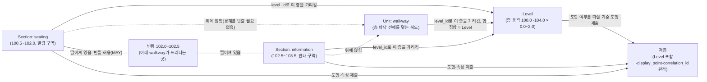

# 17) Section 레이어 태깅 규칙 — Unit 위에 주제 구역을 어디까지 긋고 무엇을 붙이는가

## 요약

IMDFrnt에서 "Section 태깅"은 도면 위에 다각형을 그려 Section Feature로 지정하고 `category`·`name` 같은 속성을 채우는 작업이다. Section은 Unit과 목적이 다르다.

- **Unit**은 한 층 바닥을 방·복도·계단 같은 물리적 공간 조각으로 **빈틈없이** 나눈다. Unit들을 합치면 Level과 정확히 같아야 한다(MUST).
- **Section**은 그 Unit 위에 "체크인 구역", "푸드코트", "보안검색 구역"처럼 **운영상 하나의 주제로 묶이는 범위**를 대략 얹는다. 층을 덮을 의무가 없고, Section끼리 떨어져 있어도 된다.

스펙이 Section에 두는 규칙은 세 갈래다.

1. **범위 규칙** — 안에 어떤 Unit·Fixture가 들어갈지는 나중에 생각하고, 먼저 운영 주제와 보행자가 "여기가 그 구역"이라고 인식하는 범위로 긋는다. 벽으로 일부만 둘러싸여도 되고, 출입구(Opening)는 붙이지 않는다. 반드시 참조한 Level 안에 있어야 한다.
2. **category 규칙** — Unit처럼 "이 경우엔 반드시 이 값"이라는 조항이 없다. 71개 값 중 Glossary 정의문이 공간에 맞는 것을 고른다.
3. **속성 규칙** — `category`와 `level_id`만 필수다. `correlation_id`는 다른 층의 짝이 있을 때만, `parents`는 부모 Section만 가리킨다.

원문 전문은 [[src15. IMDF Section·Geofence properties 전수 대조와 카테고리 열거형 조사]](속성·규칙·검증)와 [[src21. IMDF Section 태깅 규칙 보충 원문 조사 — Glossary 카테고리 정의·그림 설명·Venue 가이던스]](category 정의·그림 설명·가이던스)에 있다.

---

## 1. 먼저 알아 둘 낱말

| 낱말 | 뜻 | 예시 |
| --- | --- | --- |
| Section | 한 층 안에서 운영상 하나로 묶이는 주제 구역의 대략적 범위. Unit 위에 얹힌다 | 공항 체크인 카운터들이 모인 구역 전체 |
| 테마(theme) | 스펙이 쓰는 말. "같은 목적으로 운영되는 것들의 묶음"을 뜻한다 | 보안검색, 식사, 수하물 수취 |
| threshold | 문턱·바닥 선·띠처럼 바닥에 있거나 추론할 수 있는 경계. 넘으면 다른 공간으로 들어간다 | 바닥 색이 바뀌는 선 |
| indeterminate border | 정해지지 않은 테두리. 벽도 선도 없이 "대략 이쯤"인 경계 | 로비 한쪽에 의자가 모인 휴게 공간의 가장자리 |
| Venue Organization | 그 건물의 정보를 관리할 권한이 있는 기관. 스펙의 "운영주체" | 도서관이라면 도서관 운영 부서 |
| [[walkway]] | 보행 통로 Unit category. Section 사이 빈틈으로 보이는 바닥이 대개 이것이다 | 복도 |
| `level_id` | Section이 속한 층(Level)의 id. 필수 | 1층 Level의 UUID |
| `correlation_id` | 여러 층에 같은 성격으로 있는 Section들이 함께 갖는 임의의 UUID. 다른 Feature의 id가 아니다 | 1층·2층 열람 구역이 같은 값 |
| `parents` | 이 Section을 감싸는 상위 Section들의 id 배열 | 매장 안 "신발 코너"의 부모 = "매장 전체" |
| MUST / SHOULD / MAY | 규칙의 강도. 반드시 / 권장(이유가 있으면 예외 가능) / 해도 됨 | — |
| Violation / Warning / Info | 검증 결과의 무게. 위반 / 경고 / 참고 정보 | — |

## 2. Section과 Unit은 무엇이 다른가

같은 다각형 레이어처럼 보이지만 규칙의 성격이 다르다.

| 비교 | Unit | Section |
| --- | --- | --- |
| 정의 문형 | "presence and **physical** extent" (물리적 범위) | "presence and **approximate thematic** extent" (대략적 주제 범위) |
| 경계 | 벽·문 같은 물리적 경계를 따른다 | 문턱이나 정해지지 않은 테두리여도 된다 |
| 층을 덮는가 | 합집합 = Level (MUST, 빈틈·삐져나감 없음) | 덮을 의무 없음. Section 사이 빈틈 허용(MAY) |
| 서로 겹침 | 겹치면 Warning | 같은 층에서 겹치면 **Info**(참고) |
| 구멍(내부 링) | 검증 항목 없음 | Info로 지적됨(`SectionHasInteriorRing`) |
| 출입구 | Opening이 Unit 경계 위에 놓인다(MUST) | Opening으로 Section 입구를 나타내지 않는다(SHOULD NOT) |
| category별 규칙 | 있음(elevator·stairs·walkway·nonpublic 등) | 없음 |
| 층 참조 | `level_id` 하나 | `level_id` 하나(Geofence와 달리 여러 층 불가) |

결과적으로 한 층의 바닥은 **Unit이 먼저 빈틈없이 덮고**, Section은 그 위에 필요한 곳에만 얹는다. Section이 없는 곳에서는 아래 Unit(대개 `walkway`나 `room`)이 지도에 그대로 보인다. 스펙 그림 설명은 이를 "the 'room' or 'walkway' Unit category is 'exposed' where the Section does not cover the Unit"(Section이 덮지 않은 곳에서 아래 Unit이 드러난다)이라고 표현한다(`retaildepartment` 그림).

Section은 Unit을 대신하지 않는다. 스펙의 `private` 그림은 실제로는 방 여러 개인 곳을 "지도를 단순하게 하려고" Section 하나로 표현한 예다. 그래도 그 자리 바닥은 Unit 합집합 = Level 규칙 때문에 어떤 Unit으로든 덮여 있어야 한다. Section으로 단순하게 보이게 하는 것과, 아래를 Unit으로 채우는 것은 별개의 의무다(해석).

## 3. 범위 규칙 — 어디까지 긋는가

### 3-1. 안에 든 것보다 운영 주제를 먼저 본다 (SHOULD NOT / SHOULD)

> The Venue Organization SHOULD NOT, at first, be overly concerned with Units, Kiosks, and Fixtures that could or should be within a Section. The Venue Organization SHOULD first assess the physical environment and attempt to conceptualize a Section's extent as an operational and psychological theme

처음부터 "이 범위 안에 어느 Unit·Kiosk·Fixture가 들어가야 하나"를 따지지 말고, 먼저 현장을 보고 운영 주제로서의 범위를 잡으라는 순서 규정이다. 주제에 속하는 것으로 스펙은 세 가지를 든다.

| 구분 | 원문 요지 | 예시(공항 체크인) |
| --- | --- | --- |
| Venue Infrastructure & Operations | 그 업무를 위해 존재하는 시설·인력·장비 | 체크인 카운터, 수하물 컨베이어 |
| Business Services & Amenities | 보행자가 그 구역을 지나거나 머무는 동안 쓰라고 있는 서비스·편의시설 | 대기 줄 안내판, 근처 저울 |
| Traversal Capabilities | 그 업무가 없었다면 없었을 이동 설비·구조물 | 체크인 구역 전용 출입 통로 |

### 3-2. 보행자의 인식을 반드시 고려한다 (MUST)

> Psychology. The Venue Organization MUST take into account:
> - The pedestrian's perception of reality and conceptualize a thematic extent that includes feature types that a pedestrian would "naturally" associate with the operational theme
> - The pedestrian's conscious awareness and their belief about where they are physically located in a Venue and how tightly coupled that belief is to the proposed extent of an operational theme

두 줄의 뜻은 다음과 같다.

1. 보행자가 자연스럽게 "이것도 그 구역에 속한다"고 여길 것을 범위에 넣는다.
2. 보행자가 "지금 나는 그 구역 안에 있다"고 믿는 범위와 Section 범위가 잘 맞아야 한다.

예를 들어 체크인 카운터 앞 대기 줄이 서는 바닥은 카운터 자체가 아니어도 보행자 입장에서는 체크인 구역이다. 그래서 범위에 넣는 쪽이 맞다.

### 3-3. 벽으로 일부만 둘러싸여도 된다 (SHOULD)

> A Section SHOULD model a theme whose interpreted extent is entirely or only partially enclosed by physical, vertical barriers.

거의 모든 category 정의문이 "an open or semi-enclosed environment"(열린 또는 반쯤 둘러싸인 환경)를 쓴다. 푸드코트 그림 설명은 이 조건을 직접 보여 준다. 그 Section은 여러 `room` Unit에 맞닿고, `walkway` Unit과 Level 안에 있으며, 벽으로 일부만 둘러싸인 환경을 나타낸다.

### 3-4. Section 사이 빈틈은 둬도 된다 (MAY)

> Depending upon the map context, "gaps" MAY exist among Sections to facilitate visibility of the underlying "walkway" Unit that is intended for pedestrian use.

Section들을 서로 붙여 층을 다 덮을 필요가 없다. 오히려 사이를 비워 두면 그 아래 `walkway` Unit이 드러나 보행 경로가 지도에서 보인다. `retaildepartment` 그림은 Section 일부는 맞닿고 일부는 떨어져 있으며, 그 빈틈으로 매장 안 통로망이 드러나는 예다.

### 3-5. 출입구를 Opening으로 두지 않는다 (SHOULD NOT)

> An Opening SHOULD NOT be used to model an entrance to a Section
> - Occasionally, this is an illusion that is the consequence of a Unit legitimately requiring an Opening, and the Unit covers the boundary of a Section.

Section에는 문을 달지 않는다. Section 경계에 문이 있는 것처럼 보이는 경우가 있는데, 그것은 아래 Unit에 정당하게 필요한 Opening이 마침 Section 경계와 겹친 것이다. 문은 Unit의 것이고 Section의 것이 아니다.

### 3-6. 반드시 참조한 Level 안에 있다 (Violation)

`SectionMustBeCoveredByReferencedLevel` — Section이 `level_id`로 가리킨 Level 도형 안에 있어야 한다. 층 외곽을 넘어가면 위반이다. Glossary의 "Within"은 "첫 도형이 둘째 도형 안에 완전히 들어 있음"이다.

### 3-7. 겹침·구멍은 참고 정보 (Info)

- `SectionsOverlap` — 같은 Level의 Section 내부가 겹치면 Info로 알린다. 금지는 아니다.
- `SectionHasInteriorRing` — Section에 구멍이 있으면 Info로 알린다. 금지는 아니다.
- 도형은 Polygon 또는 MultiPolygon(`SectionMustHavePolygonalGeometry`, Violation). 떨어진 두 조각을 한 Section으로 묶을 수 있다.

### 실무 순서

1. 층의 Unit 태깅을 먼저 끝낸다(합집합 = Level). Section은 Unit을 대신하지 않는다.
2. 운영 주제를 정한다. "이 층에서 방문자에게 하나의 구역으로 안내할 것이 무엇인가"를 적는다.
3. 주제마다 보행자가 그 구역이라고 인식하는 범위로 다각형을 긋는다. 안에 든 Unit 경계에 맞추려고 애쓰지 않는다.
4. 통로가 보여야 하는 곳은 Section 사이를 비운다.
5. Level 밖으로 나간 곳이 없는지, Opening을 Section에 붙이지 않았는지 확인한다.

## 4. category 고르기

### 4-1. category별 강제 규칙이 없다

Unit 페이지에는 Category Specific Rules 절이 있지만 Section 페이지에는 없다. 전용 그림 해설 페이지(Illustrative Guidance)도 없다. 근거는 Glossary의 category 정의문뿐이다. 71개 중 45개는 정의가 있고, 26개(`arcade`, `gambling` 계열 22개, `recreation`, `rental`, `walkway`)는 Section 정의가 없다([[src21. IMDF Section 태깅 규칙 보충 원문 조사 — Glossary 카테고리 정의·그림 설명·Venue 가이던스]] 2절).

`unspecified`(미지정)가 없다. 맞는 값이 없다고 아무 값이나 넣을 수 없으므로, 맞는 값이 없는 구역은 Section으로 만들지 않는 것도 선택지다. Section은 필수 레이어가 아니다(해석).

### 4-2. 성격별 묶음

| 묶음 | 값 | 판단 근거(정의문 요지) |
| --- | --- | --- |
| 공항·교통 운영 | `checkin`, `baggageclaim`(`.intl`), `gatearea`(`.holding`), `immigration`(`.schengen`), `security`, `presecurity`, `postsecurity`, `paidarea`, `platform`, `ticketing`, `recomposearea` | 해당 업무가 이뤄지는 구역 |
| 상업 | `retail`, `retaildepartment`, `dutyfree`, `concessions`, `rental`, `carrental`(`.dropoff`) | 판매·대여 업무 구역. `retaildepartment`의 상품 분류는 운영주체가 정한다 |
| 식사·휴식·좌석 | `eatingdrinking`, `seating`, `seatingrow`, `recreation` | 공용 식사 공간, 좌석 환경, 좌석 한 줄 |
| 전시·오락 | `exhibit`, `exhibition`, `entertainmentarea`(`.game`·`.music`·`.performance`·`.sport`), `arcade`, `gambling` 계열 | 전시·공연·경기·게임 |
| 업무·안내·관리 | `information`, `servicearea`, `cubicle`, `private` | 안내 제공, 서비스 업무, 칸막이 업무 공간, 운영주체가 비공개로 보는 구역 |
| 차량·주차 | `parking` 계열 9개, `parkandride`, `road` | 차량 보관·주행 |
| 기타 | `vegetation`, `walkway` | 식재 구역. `walkway`는 정의 없음(확인 필요) |

### 4-3. 상위 값을 쓰는 경우

`entertainmentarea`·`information`·`parking`·`retail`·`security`·`servicearea` 여섯 개 정의에는 "should be used when an area cannot be classified using any other category in the hierarchy"(계층 안의 다른 값으로 분류할 수 없을 때 쓴다)가 붙는다. 예를 들어 전기차 전용 주차 구역이면 `parking.ev`, 어떤 하위 값에도 맞지 않는 일반 주차 구역이면 `parking`이다. 이 "hierarchy"가 SECTION-CATEGORY 전체를 뜻하는지는 원문에 없다(확인 필요).

### 4-4. Section과 다른 Feature를 고르는 기준이 그림에 나온 경우

- **장비는 Fixture, 구역은 Section.** 출입국 심사대가 충분히 크면 개별 `immigration.desk` Fixture 후보가 되고, 심사 업무 범위 전체는 `immigration` Section이다. 보안검색 장비도 Fixture로 그릴 수 있지만, "보안검색 구역은 `security` Section으로 범위만 정하고 display_point를 대표점으로 쓰는 방식"이 선호된다(preferred approach).
- **같은 Unit 안을 나눌 때 Section.** 기차 승강장 전체는 `platform` Unit 하나이고, 용도와 이름이 다른 양쪽 면을 `platform` Section 두 개로 나눌 수 있다.
- **층 전체가 하나의 주제일 때.** 옥외 주차층 그림은 `parking` Level과 똑같은 `parking` Section에 display_point를 둔 예다.
- **보안 전후 같은 정책 구역은 Geofence도 가능.** `paidarea`·`platform`·`presecurity`·`postsecurity`는 Section과 Geofence 양쪽에 있다. 그림에는 `security` Section 두 개가 `presecurity`·`postsecurity` Geofence 모두에 맞닿은 예가 있다. 어느 쪽을 쓸지 정한 문장은 없다(확인 필요). 여러 층·여러 건물에 걸치면 층 하나만 참조하는 Section으로는 표현할 수 없으므로 Geofence가 된다.

### 4-5. 도서관에 적용한다면 (해석)

도서관용 Venue 가이던스는 없다. 아래는 정의문을 근거로 한 판단이며 **확인 필요**다.

| 도서관 공간 | 후보 | 근거와 주의 |
| --- | --- | --- |
| 칸막이 없이 열람석이 모인 구역 | `seating` | "open or semi-enclosed seating environment". 방 하나가 통째로 열람실이면 Unit(`library`·`room` 등)만으로 충분할 수 있다 |
| 칸막이 개인 열람석(캐럴) 구역 | `seating` 또는 `cubicle` | `cubicle`은 "partially enclosed office workspace"라 업무 공간 뉘앙스가 있다 |
| 안내·대출반납 데스크 주변 | `information` 또는 `servicearea` | 데스크 자체는 Fixture(`desk`) 후보, 줄 서는 범위까지 Section |
| 직원 업무 구역(방 여러 개) | `private` | `private` 그림과 같은 용법. 출입 제한 표시는 `restriction`(`employeesonly`) 또는 아래 Unit의 `nonpublic`과 구분해야 한다([[15) 비개방 구역은 IMDF에서 어떻게 그리는가 — nonpublic과 restriction]]) |
| 전시 공간 | `exhibit` / `exhibition` | 상설 전시물 하나면 `exhibit`, 기획 전시 구역이면 `exhibition`에 가깝다 |
| 서가 구역(예: 000~300번대) | **맞는 값 없음** | `retaildepartment`는 "상품·서비스 분류 구역"이라 구조는 비슷하지만 판매 맥락이다. 서가 위치는 클라이언트 요구대로 Fixture 도형과 별도 매핑으로 다루고, Section은 만들지 않는 쪽이 안전하다 |

## 5. 속성 채우기

| 속성 | 필수 | 규칙 |
| --- | --- | --- |
| `category` | 필수 | 71개 목록 값만(`SectionMustHaveCategory`·`SectionCategoryMustBeValid`, Violation) |
| `level_id` | 필수 | 층 하나(`SectionMustReferenceLevel`, Violation). 그 Level 안에 있어야 함 |
| `name` | 선택 | 운영주체가 선언한 이름. LABELS(언어별) 형식. 비우려면 null, 빈 문자열은 위반(`LabelMustNotBeBlank`) |
| `alt_name` | 선택 | `name` 없이 `alt_name`만 두면 Warning(`HasOnlyAltName`) |
| `display_point` | 선택(공항은 일부 MUST) | Section 안의 점. 밖이면 Warning. 공항 가이던스는 `checkin`·`baggageclaim`·`immigration`·`security` Section에 display_point를 MUST로 요구한다 |
| `restriction` | 선택 | `employeesonly`·`restricted`. Section 전체에 적용되는 제한 |
| `accessibility` | 선택 | 값의 **배열**. 스펙 예제는 문자열로 적혀 있지만 표의 규정(배열)을 따른다 |
| `address_id` | 선택 | Address 참조. 쓸 일이 드물다 |
| `correlation_id` | 선택 | 여러 Section을 연결하려는 의도가 있으면 반드시 둔다(MUST). 같은 값을 가진 Section이 **최소 둘**(혼자면 Violation), 그들은 **서로 다른 층**(같은 층이면 Violation), category는 같게(다르면 Warning). UUID v4 형식 |
| `parents` | 선택 | 부모 Section의 id만(다른 Feature Type 금지). 중복·자기 자신·순환 금지. 자식은 넣지 않는다. 배열이라 부모가 여럿일 수 있다 |

`correlation_id` 예: 1층과 2층에 같은 성격의 열람 구역이 있으면 두 `seating` Section에 같은 UUID를 넣는다. 2층에만 있고 짝이 없는 Section에 값을 넣으면 오히려 위반이다.

`parents` 예: "매장 전체" `retail` Section 안에 "신발 코너" `retaildepartment` Section이 있으면, 신발 코너의 `parents`에 매장 전체의 id를 넣는다. 매장 전체 쪽에는 아무것도 넣지 않는다.

## 6. 검증 — 어떤 실수가 막히는가

| 실수 | 규칙 | 심각도 |
| --- | --- | --- |
| category 비움 / 목록에 없는 값 | `SectionMustHaveCategory` / `SectionCategoryMustBeValid` | Violation |
| 층 참조 없음 | `SectionMustReferenceLevel` | Violation |
| 층 외곽 밖으로 나감 | `SectionMustBeCoveredByReferencedLevel` | Violation |
| Point·LineString으로 그림 | `SectionMustHavePolygonalGeometry` | Violation |
| correlation_id 짝 없음 / 짝이 같은 층 | `CorrelationIdMustBeMatched` / `LevelIDsMustBeDissimilarForCorrelationID` | Violation |
| id·correlation_id가 UUID v4가 아님 | `InvalidFeatureID` / `InvalidCorrelationID` | Violation |
| display_point가 Point가 아님 / Section 밖 | `DisplayPointMustBePointGeometry` / `SectionGeometryMustContainDisplayPoint` | Violation / Warning |
| correlation_id 짝끼리 category 다름 | `CategoryShouldBeSameForCorrelationID` | Warning |
| 같은 층 Section끼리 겹침 | `SectionsOverlap` | Info |
| 구멍 있음 | `SectionHasInteriorRing` | Info |

Unit과 비교하면, Section의 도형 관련 규칙 중 무거운 것은 "Level 안에 있을 것" 하나뿐이다. 겹침·구멍·빈틈은 막히지 않는다.

## 7. GeoJSON 예시 — 복도 위의 열람 구역과 안내 구역

층(Level) 전체가 [100.0, 0.0]–[104.0, 2.0] 직사각형이고 그 바닥을 `walkway` Unit 하나가 덮고 있다고 가정한다. 그 위에 열람석 구역(`seating`)과 안내 구역(`information`) Section 두 개를 떨어뜨려 얹는다. 좌표는 스펙 예시처럼 단순한 값을 썼다.

```json
{
  "type": "FeatureCollection",
  "features": [
    {
      "id": "cccccccc-cccc-4ccc-8ccc-cccccccccccc",
      "type": "Feature",
      "feature_type": "section",
      "geometry": {
        "type": "Polygon",
        "coordinates": [[[100.5, 0.5], [102.0, 0.5], [102.0, 1.5], [100.5, 1.5], [100.5, 0.5]]]
      },
      "properties": {
        "category": "seating",
        "restriction": null,
        "accessibility": null,
        "name": { "ko": "열람 구역", "en": "Reading Area" },
        "alt_name": null,
        "display_point": { "type": "Point", "coordinates": [101.25, 1.0] },
        "level_id": "22222222-2222-4222-8222-222222222222",
        "address_id": null,
        "correlation_id": null,
        "parents": null
      }
    },
    {
      "id": "dddddddd-dddd-4ddd-8ddd-dddddddddddd",
      "type": "Feature",
      "feature_type": "section",
      "geometry": {
        "type": "Polygon",
        "coordinates": [[[102.5, 0.5], [103.5, 0.5], [103.5, 1.5], [102.5, 1.5], [102.5, 0.5]]]
      },
      "properties": {
        "category": "information",
        "restriction": null,
        "accessibility": null,
        "name": { "ko": "안내 데스크", "en": "Information Desk" },
        "alt_name": null,
        "display_point": { "type": "Point", "coordinates": [103.0, 1.0] },
        "level_id": "22222222-2222-4222-8222-222222222222",
        "address_id": null,
        "correlation_id": null,
        "parents": null
      }
    }
  ]
}
```

같은 코드에 줄마다 설명을 붙인 버전이다. JSON은 주석 문법이 없으므로 이 버전은 읽기용이며 실제 파일에는 쓰지 않는다.

```json
{
// 중괄호 { 는 "이름: 값" 쌍을 묶는 객체의 시작이다. 이 객체가 section.geojson 파일 전체다.
  "type": "FeatureCollection",
// 이 파일이 Feature 여러 개를 담은 묶음(FeatureCollection)이라고 GeoJSON 규격에 알린다.
  "features": [
// features 칸에 Section들을 대괄호 [ ] 배열(순서 있는 목록)로 나열한다.
    {
// 첫 번째 Section(열람 구역)의 시작.
      "id": "cccccccc-cccc-4ccc-8ccc-cccccccccccc",
// 이 Section의 고유 번호. UUID v4 형식이어야 한다(InvalidFeatureID 검증). 세 번째 묶음 첫 글자 4가 "버전 4" 표시다.
      "type": "Feature",
// GeoJSON 규격상 이 객체가 Feature 하나라는 표시.
      "feature_type": "section",
// IMDF 쪽 표시. 이 Feature가 Section 레이어 소속이라는 뜻이며 소문자 "section"으로 고정이다.
      "geometry": {
// 도형 정보의 시작.
        "type": "Polygon",
// 도형 종류는 닫힌 다각형. Section은 Polygon 또는 MultiPolygon만 허용된다.
        "coordinates": [[[100.5, 0.5], [102.0, 0.5], [102.0, 1.5], [100.5, 1.5], [100.5, 0.5]]]
// 꼭짓점 목록. [경도, 위도] 쌍이고 마지막 점을 첫 점과 같게 써서 닫는다. 층(100.0~104.0 × 0.0~2.0) 안쪽에 있어 Level 포함 검증을 통과한다. 아래 walkway Unit 경계와 맞출 필요는 없다.
      },
// 도형 정보의 끝.
      "properties": {
// 속성 칸의 시작.
        "category": "seating",
// 용도는 좌석이 모인 환경. SECTION-CATEGORY 목록 값이어야 한다(필수).
        "restriction": null,
// 출입 제한 없음. null은 "값이 비어 있음"을 뜻한다.
        "accessibility": null,
// 접근성 정보 없음. 넣는다면 문자열 하나가 아니라 ["wheelchair"]처럼 배열로 넣는다.
        "name": { "ko": "열람 구역", "en": "Reading Area" },
// 구역 이름. 언어 코드별로 적는 LABELS 형식이다.
        "alt_name": null,
// 별칭 없음.
        "display_point": { "type": "Point", "coordinates": [101.25, 1.0] },
// 이름표를 찍을 대표점. 구역 한가운데이며 Section 도형 안에 있어야 한다(밖이면 Warning).
        "level_id": "22222222-2222-4222-8222-222222222222",
// 이 구역이 속한 층(Level)의 id(필수). 층 하나만 가리킬 수 있다.
        "address_id": null,
// 주소 참조 없음.
        "correlation_id": null,
// 다른 층에 짝이 될 열람 구역이 없으므로 비운다. 짝 없이 값을 넣으면 위반이다.
        "parents": null
// 감싸는 상위 Section이 없으므로 비운다.
      }
// 속성 칸의 끝.
    },
// 첫 번째 Section의 끝. 쉼표는 다음 Feature가 이어진다는 뜻이다.
    {
// 두 번째 Section(안내 구역)의 시작.
      "id": "dddddddd-dddd-4ddd-8ddd-dddddddddddd",
// 안내 구역 Section의 고유 번호.
      "type": "Feature",
// GeoJSON Feature 표시.
      "feature_type": "section",
// 이것도 Section 레이어 소속.
      "geometry": {
// 도형 정보의 시작.
        "type": "Polygon",
// 닫힌 다각형.
        "coordinates": [[[102.5, 0.5], [103.5, 0.5], [103.5, 1.5], [102.5, 1.5], [102.5, 0.5]]]
// 왼쪽 변이 x = 102.5다. 열람 구역 오른쪽 변(x = 102.0)과 0.5만큼 떨어져 있다. 그 빈틈으로 아래 walkway Unit이 지도에 보인다(MAY).
      },
// 도형 정보의 끝.
      "properties": {
// 속성 칸의 시작.
        "category": "information",
// 용도는 안내 제공 구역. 하위 값이 없는 값이다.
        "restriction": null,
// 출입 제한 없음.
        "accessibility": null,
// 접근성 정보 없음.
        "name": { "ko": "안내 데스크", "en": "Information Desk" },
// 구역 이름. 데스크 가구 자체는 이 Section이 아니라 Fixture(desk)로 따로 그릴 수 있다.
        "alt_name": null,
// 별칭 없음.
        "display_point": { "type": "Point", "coordinates": [103.0, 1.0] },
// 이름표 위치. 안내 구역 한가운데.
        "level_id": "22222222-2222-4222-8222-222222222222",
// 열람 구역과 같은 층.
        "address_id": null,
// 주소 참조 없음.
        "correlation_id": null,
// 층간 짝 없음.
        "parents": null
// 상위 Section 없음.
      }
// 속성 칸의 끝.
    }
// 두 번째 Section의 끝.
  ]
// features 배열의 끝.
}
// 파일 전체 객체의 끝.
```

두 Section은 겹치지 않고 층을 다 덮지도 않는다. 둘 다 Level 안에 있으므로 Violation이 없다. 출입구 Opening은 어느 Section에도 붙어 있지 않다.



| 노드 | 의미 |
| --- | --- |
| Level | 한 층 전체 윤곽. Section이 그 안에 있어야 하는 기준 도형 |
| Unit: walkway | 층 바닥을 빈틈없이 덮는 Unit. Section이 없는 곳에서 지도에 보인다 |
| Section: seating | 열람석이 모인 주제 구역 |
| Section: information | 안내 업무가 이뤄지는 주제 구역 |
| 빈틈 | 두 Section 사이에서 아래 walkway가 드러나는 자리 |
| 검증 | `SectionMustBeCoveredByReferencedLevel`, `SectionGeometryMustContainDisplayPoint`, `SectionsOverlap` 등 |

| 화살표 | 의미 |
| --- | --- |
| Unit·Section → Level | 각 Feature의 `level_id`가 Level의 `id`를 가리키는 참조 관계 |
| Section ⇢ Unit(점선) | Section이 Unit 위에 겹쳐 놓이는 관계. 데이터 필드가 아니라 좌표가 겹쳐서 생기는 관계이며 경계를 맞출 의무가 없다 |
| Section — 빈틈 | Section끼리 떨어져 있어 사이에 바닥이 드러나는 배치 |
| Section·Level → 검증 | 검증기가 Section 도형이 Level 안에 있는지, 대표점이 Section 안에 있는지, 겹치는지를 계산 |

## 8. IMDFrnt에서의 적용

레포 `/Users/sionlee/Documents/GitHub/IMDFrnt` 커밋 `bec89f3`과 작업 트리 기준(2026-10-18 21:36 확인). 코드는 수정하지 않았다.

| 스펙 규칙 | IMDFrnt 현황 | 비고 |
| --- | --- | --- |
| Property Keys 10개 | 7개(`Model/PropertySchema.swift:183~195`) | `address_id`·`correlation_id`·`parents` 없음. 층간 짝·부모 Section을 표현할 수 없다 |
| `category` 71개, `unspecified` 없음 | 71개 드롭다운(`PropertySchema.swift:306~`) | 일치. 주석은 "70종"으로 남아 있음 |
| `restriction`·`accessibility`·`alt_name` | 항상 null | 스펙상 null 허용이라 위반은 아님 |
| geometry POLYGONAL | Polygon만(`Model/IMDFFeatureType.swift:23`) | 떨어진 두 조각을 한 Section으로 만들 수 없음 |
| Opening을 Section 입구로 쓰지 않음(SHOULD NOT) | `canBorrowOpenings`가 Section도 true(`IMDFFeatureType.swift:46~51`) | 스펙 권고와 반대. Section을 제외하거나 근거를 주석으로 남길지 결정 필요 |
| 경계가 벽이 아니어도 됨, 빈틈 허용 | 안내문(`IMDFFeatureType.swift` `note`)에 명시 | 일치 |
| Section이 Level 안에 있을 것(Violation) | 내보내기 검사 확인 안 됨 | 확인 필요 |
| display_point | 찍기 버튼 있음(`hasDisplayPoint`) | Section 안 포함 검사 유무는 확인 필요 |

## 관련 링크

- [[src15. IMDF Section·Geofence properties 전수 대조와 카테고리 열거형 조사]] — Section 속성 10개·Capturing Rules·Validations 23건 원문
- [[src21. IMDF Section 태깅 규칙 보충 원문 조사 — Glossary 카테고리 정의·그림 설명·Venue 가이던스]] — category 정의문·그림 설명·가이던스 원문
- [[Section]] — Section Feature Type 개념
- [[SECTION-CATEGORY]] — category 값 목록과 분류
- [[16) Unit 레이어 태깅 규칙 — 무엇을 한 Unit으로 자르고 어떤 category를 붙이는가]] — Section 아래를 덮는 Unit의 규칙
- [[walkway]] — Section 사이로 드러나는 통로 Unit
- [[Display Point]] — 대표점 속성
- [[Level]] — Section이 들어 있어야 하는 층 도형
- [[15) 비개방 구역은 IMDF에서 어떻게 그리는가 — nonpublic과 restriction]] — `private` Section과 `nonpublic` Unit·`restriction` 구분
- [[08) IMDF Feature Type·카테고리 전체 레퍼런스]] — 전체 Feature Type과 열거형

## 미해결 질문

- Section `walkway`는 언제 쓰는가. 같은 자리의 `walkway` Unit과 어떻게 구분하는가 — Glossary에 Section 정의가 없다.
- "cannot be classified using any other category in the hierarchy"의 "hierarchy"가 하위 계층인지 SECTION-CATEGORY 전체인지.
- `paidarea`·`platform`·`presecurity`·`postsecurity`를 Section과 Geofence 중 무엇으로 그리는가(층 하나 안이면 둘 다 가능해 보임).
- 도서관 공간의 Section category 대응(4-5절)은 해석이다. Apple Maps Connect 검수나 실제 도서관 IMDF 사례로 확인 필요. 특히 서가 구역을 Section으로 표현해야 하는가.
- Apple 지도 앱이 Section을 어떻게 그리는가(색·이름표·탭 동작). MapKit 렌더링 문서 확인 필요.
- IMDFrnt가 내보내기 전에 Section이 Level 안에 있는지, display_point가 Section 안에 있는지 검사하는가.
