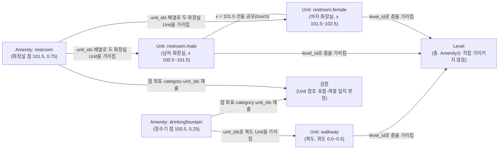

# 18) Amenity 레이어 태깅 규칙 — 편의시설을 점 하나로 어디에 찍고 무엇을 연결하는가

## 요약

IMDFrnt에서 "Amenity 태깅"은 도면 위에 점 하나를 찍어 Amenity Feature로 지정하고 `category`·`unit_ids` 같은 속성을 채우는 작업이다. Amenity는 Unit·Section과 성격이 다르다.

- **Unit**은 공간의 **면적**(방·복도 모양)을, **Section**은 주제 구역의 **대략적 범위**를 다각형으로 그린다.
- **Amenity**는 화장실·엘리베이터·ATM·정수기·안내데스크처럼 보행자가 쓰는 편의시설이 **있다는 사실과 그 대략의 위치**를 **점 하나**로 나타낸다.

스펙이 Amenity에 두는 규칙은 네 갈래다.

1. **위치 규칙** — 가능하면 실제 위치에 찍는다(MUST). Wi-Fi처럼 실제 위치가 없거나, 엘리베이터처럼 Unit으로 그릴 수 없거나, Unit·Fixture의 대표점으로 표시하기 마땅치 않을 때 쓴다(SHOULD). 같은 종류가 모여 있으면 점 하나로 묶는 예가 반복된다.
2. **연결 규칙** — 층(`level_id`)을 직접 갖지 않는다. 반드시 `unit_ids`로 자기가 속한 Unit을 가리키고(Violation), 점은 그 Unit 안에 있어야 한다(Warning). 위아래 층에 포개진 같은 서비스는 `correlation_id`로 묶는다(조건부 MUST).
3. **category 규칙** — 172개 중 고른다. `unspecified`가 있다. 화장실은 묶음 가운데 추상 category 점 하나가 권장이고, 엘리베이터·계단·화장실 Unit 안에는 같은 계열 Amenity만 둔다(Warning).
4. **속성 규칙** — `category`와 `unit_ids`만 필수다. `hours`·`phone`·`website`는 형식이 엄격하다.

원문 전문은 [[src22. IMDF Amenity 태깅 규칙 원문 조사 — Property·Geometry·Category Specific Rules·Validations·가이던스]]에 있다.

---

## 1. 먼저 알아 둘 낱말

| 낱말 | 뜻 | 예시 |
| --- | --- | --- |
| Amenity | 보행자에게 실용적 쓰임이나 편의를 주는 시설·서비스가 있다는 사실과 대략의 점 위치 | 2층 정수기 위치의 점 |
| Point | GeoJSON의 점 도형. `[경도, 위도]` 좌표 하나로 된다 | `{"type": "Point", "coordinates": [129.32, 36.01]}` |
| `unit_ids` | 이 Amenity가 속한 Unit들의 id **배열**. 필수 | `["<복도 Unit의 UUID>"]` |
| [[correlation_id]] | 서로 다른 층에 있는 같은 서비스의 Amenity들이 함께 갖는 임의의 UUID. 지도 앱은 층을 고르기 전 이들을 하나로만 그린다 | 1층·2층 같은 자리 엘리베이터 점 두 개에 같은 값 |
| Fixture | 바닥에 놓인 물건의 외곽을 다각형으로 그리는 Feature | 수하물 컨베이어, 책상 |
| Kiosk | 판매대·안내 키오스크 같은 가구의 외곽 다각형. 거기서 하는 서비스는 Amenity나 Occupant가 맡는다 | 무인 안내기 |
| [[Display Point]] | Unit·Fixture 같은 다각형 Feature의 이름표 위치 점. Amenity 자신은 갖지 않는다 | 화장실 Unit의 이름표 점 |
| contained (or touched) | 검증 규칙의 판정 방식. 안에 들어 있거나 경계에 닿아 있으면 해당 | 계단 Unit 경계 위의 점 |
| within / overlap / equal | 포함됨 / 일부 겹침 / 완전히 같음 | 1층·2층 엘리베이터 Unit이 equal |
| neighboring | 벽이나 장벽 하나를 사이에 둔 이웃 공간 | 벽을 사이에 둔 남녀 화장실 |
| MUST / SHOULD / MAY | 반드시 / 권장(이유가 있으면 예외 가능) / 해도 됨 | — |
| Violation / Warning / Info | 검증 결과의 무게. 위반 / 경고 / 참고 정보 | — |

## 2. Amenity와 Unit·Section·Fixture는 무엇이 다른가

| 비교 | Unit | Section | Fixture | Amenity |
| --- | --- | --- | --- | --- |
| 도형 | Polygon/MultiPolygon | Polygon/MultiPolygon | Polygon/MultiPolygon | **Point만** |
| 정의 문형 | physical extent(물리적 범위) | approximate thematic extent(대략적 주제 범위) | 물건의 외곽 | **approximate point location**(대략의 점 위치) |
| 층 참조 | `level_id` | `level_id` | `level_id` | **없음.** `unit_ids`의 Unit을 통해 정해짐 |
| 대표점(display_point) | 있음 | 있음 | 있음 | **없음**(이미 점이므로) |
| `unspecified` category | 있음 | 없음 | — | 있음 |

판단 기준을 정리하면 다음과 같다.

- 그 시설이 **면적을 가진 방**이면 Unit이다(예: 화장실 칸 전체 = `restroom.female` Unit). Amenity는 그 위에 이름·아이콘을 찍는 점으로 추가할 수 있다.
- 그 시설이 **바닥 위 물건**이고 모양을 그릴 수 있으면 Fixture다(예: 수하물 컨베이어). 그릴 수 없으면 Amenity 점으로 대신한다.
- 그 시설이 **면적·모양을 그릴 수 없거나 의미가 없는 서비스**면 Amenity다(예: Wi-Fi 구역, 자판기, AED, 소화기).

## 3. 위치 규칙 — 점을 어디에 찍는가

### 3-1. 가능하면 실제 위치 (MUST)

> MUST model the ground-truth or approximate physical location of the represented Amenity where possible

현장 실제 위치(또는 대략의 위치)에 찍는다. 정수기가 복도 동쪽 끝에 있으면 그 자리다.

### 3-2. Amenity를 쓰는 세 경우 (SHOULD)

| 원문 | 뜻 | 예 |
| --- | --- | --- |
| SHOULD be used when no exact ground-truth based placement is possible (e.g. "wifi") | 정확한 실제 위치가 없는 서비스 | Wi-Fi 구역 표시 |
| SHOULD be used when it is not possible to explicitly model ground-truth using a Unit (e.g. "elevator") or Fixture (e.g. "baggagecarousel") | Unit이나 Fixture로 실물을 그릴 수 없을 때 | 도면에 엘리베이터 칸이 없어서 Unit을 못 만들 때 |
| SHOULD be used when the display-point capability of a Unit or Fixture is not suitable for mapping purposes | Unit·Fixture의 대표점으로 표시하기 마땅치 않을 때 | 큰 화장실 Unit의 대표점이 입구에서 멀 때 입구 근처에 Amenity 점 |

세 가이던스(공항·교통역·쇼핑센터) 모두 "원본 도면에서 Unit으로 만들 수 없으면 `elevator`·`escalator`·`movingwalkway`·`stairs` Amenity를 반드시 넣는다(MUST)"고 한다. 도면에 엘리베이터 칸이 그려져 있지 않아도 엘리베이터 점은 있어야 한다는 뜻이다.

### 3-3. 한 Unit 안에 여러 개 (MAY)

> Multiple Amenities MAY be within a single Unit

복도 Unit 하나에 정수기·소화기·AED 점이 각각 있어도 된다. 다만 같은 층에서 두 Amenity의 좌표가 완전히 같으면 Warning이다(`AmenityShouldNotEqualAmenity`).

### 3-4. 모여 있으면 점 하나로

Glossary 그림 설명이 같은 판단을 여러 번 보여 준다.

- 자동 체크인기 여러 대 → `checkin.selfservice` Amenity **하나**
- 자동 출입국 심사기 여러 대 → `immigration` Amenity **하나**
- 개찰구 줄 → `faregate` Amenity **하나**. `faregate`와 `faregate.oversized` 두 점은 라벨이 겹칠 수 있어 권하지 않는다(Not advisable). 휠체어 통로 같은 접근성 정보는 Amenity를 늘리지 말고, 개찰구마다 Opening을 그려 Opening 쪽 `accessibility`에 넣는 것이 선호된다.

같은 원리로 복사기 세 대가 한 코너에 나란히 있으면 `copymachine` 점 하나가 자연스럽다(해석).

### 3-5. 점이 들어가면 안 되는 Unit (Warning)

| Unit category | 그 안(또는 경계)에 둘 수 있는 Amenity | 규칙 |
| --- | --- | --- |
| `elevator` | `elevator`만 | `ElevatorUnitMayOnlyContainElevatorAmenity` |
| `escalator` | `escalator`만 | `EscalatorUnitMayOnlyContainEscalatorAmenity` |
| `movingwalkway` | `movingwalkway`만 | `MovingWalkwayUnitMayOnlyContainMovingWalkwayAmenity` |
| `stairs` | `stairs`만 | `StairsUnitMayOnlyContainStairsAmenity` |
| `restroom` 계열 | `restroom` 계열만 | `RestroomUnitMayOnlyContainAmenityFromRestroomHierarchy` |
| `restroom.female` | 다른 성별·family·unisex 화장실 Amenity 금지 | `FemaleRestroomUnitMustNotContainRestroomAmenityCategory` |
| `restroom.male` | 상동 | `MaleRestroomUnitMustNotContainRestroomAmenityCategory` |
| `restroom.family`·`restroom.unisex` | 다른 종류 화장실 Amenity 금지 | `RestroomUnitCategoryShouldNotContainRestroomAmenityCategory` |
| `steps`·`opentobelow` | 없음 | `StepsUnitMustNotContainAmenity`, `OpenToBelowUnitMustNotContainAmenity` |
| 구조체(`structure`·`column`·`brick` 등) | 없음 | `StructuralUnitMustNotContainAmenity` |
| Kiosk(Unit 아님) | `elevator`·`escalator`·`movingwalkway`·`stairs` 금지 | `KioskMustNotContainAmenityCategory` |

일반 `restroom` Unit 안에 `restroom.female` 같은 구체적 Amenity가 있으면 Info(`GenericRestroomUnitCategoryContainsSpecificRestroomAmenityCategory`)로 알린다.

판정이 "contained (or touched)"라는 점에 주의한다. 정수기 점을 계단실 벽 바로 앞 복도에 찍으려다 계단 Unit 경계 위에 놓이면 `StairsUnitMayOnlyContainStairsAmenity`에 걸린다. 경계에서 조금 떨어진 복도 안쪽에 찍는다.

## 4. 연결 규칙 — 무엇을 가리키는가

### 4-1. `unit_ids`는 반드시 (Violation), 점은 그 Unit 안에 (Warning)

- `unit_ids`는 `null or`가 없는 필수 속성이고, 비우면 `AmenityMustReferenceUnit`(Violation)이다.
- 점이 가리킨 Unit 안에 있지 않으면 `AmenityShouldBeCoveredByReferencedUnit`(Warning)이다. Warning인 이유는 화장실 규칙(5-2절)처럼 일부러 바깥에 두는 경우가 허용되기 때문이다.
- 배열이므로 Unit 여럿을 가리킬 수 있다. 예: 남녀 화장실 Unit 두 개 사이에 둔 `restroom` 점은 두 Unit을 모두 가리킨다(해석).
- Amenity에는 `level_id`가 없다. 어느 층인지는 `unit_ids`의 Unit이 가진 `level_id`로 정해진다.

### 4-2. 위아래로 포개진 같은 서비스는 `correlation_id`로

세 조건이 **모두** 맞으면 반드시 넣는다(MUST).

1. 서로 다른 층의 Unit 안에 있다.
2. 그 Unit들이 서로 within·overlap·equal이다 — 즉 같은 서비스가 바로 위나 바로 아래에 있다.
3. 층을 고르기 전 지도에 하나만 보여야 한다.

예: 1~4층을 관통하는 엘리베이터의 `elevator` Amenity 네 개에 같은 UUID를 넣으면, 층을 고르기 전 지도에는 엘리베이터 아이콘이 하나만 그려진다. 같은 층 여기저기 흩어진 소화기들을 묶는 데는 쓰면 안 된다(MUST NOT). `parking` 계열은 이 조건이 맞으면 반드시 넣으라고 category 규칙에서 한 번 더 강조한다.

검증: 짝이 없으면 Violation(`CorrelationIdMustBeMatched`), 짝끼리 같은 층이면 Violation(`LevelIDsMustBeDissimilarForCorrelationID`), category가 다르면 Warning(`CategoryShouldBeSameForCorrelationID`).

### 4-3. 다른 Feature와의 관계

- **Level의 Opening 예외:** Level은 최소 하나의 Opening이 가리켜야 하지만(MUST), 수직 이동 Amenity(엘리베이터·계단 등)가 그 Level 안에 있으면 예외다. 엘리베이터로만 갈 수 있는 층이 이 경우다.
- **Kiosk:** Kiosk는 물건 외곽만 그리고, 거기서 하는 서비스는 Amenity(또는 Anchor를 통한 Occupant)가 맡는다. Amenity를 Kiosk 안에 둬도 된다(MAY).
- **Section의 display_point 대신:** 공항·교통역 가이던스는 `immigration`·`security.checkpoint`·`security.inspection` Amenity에 "If preferred over Section display_point"라는 비고를 단다. 구역은 Section으로, 아이콘 위치는 Amenity 점으로 나눠 맡길 수 있다는 뜻으로 읽힌다(해석).

## 5. category 고르기

### 5-1. 목록과 특징

- 172개. 위키의 이전 기록(src11)과 IMDFrnt 주석의 "약 160"은 정확하지 않다.
- **`unspecified`가 있다.** "다른 어떤 Amenity category로도 분류할 수 없는" 것에 쓰며, 이때는 이름을 넣어야 한다(`UnspecifiedAmenityShouldHaveName`, Warning).
- 135개에 Glossary 정의가 있고, 37개는 없다. 도서관과 관련 있는 **`library`도 정의가 없다.**
- 상위 값의 용법: `parking`·`security`·`service`·`ticketing`·`transit`·`boardinggate` 정의에는 "다른 category로 분류할 수 없을 때 쓴다"는 문장이 붙는다. 예를 들어 전기차 충전 주차 표시는 `parking.ev`, 그 밖의 일반 주차 표시는 `parking`이다.
- 이름과 category를 같게 쓰지 않는다(`AmenityNameAndCategoryAreSame`, Warning). 예: category `atm`에 name `"ATM"`. 이름이 category를 반복할 뿐이면 비운다.

### 5-2. 화장실 (권장 규칙)

> When multiple Units representing restrooms with dissimilar category touch:
> - Centrally locate the Amenity among the Units
> - Select an Amenity category that is suitably abstract and describes the intended purpose of all the Units of dissimilar category
>
> MAY be positioned outside the boundary of a collection of Units that touch or neighbor one another when this is the most practical way to symbolize the existence of the restrooms

남자 화장실(`restroom.male` Unit)과 여자 화장실(`restroom.female` Unit)이 붙어 있으면 다음과 같이 한다.

1. Amenity 점은 **하나**만, 두 Unit **가운데**에 둔다.
2. category는 둘을 아우르는 **`restroom`**으로 한다. `restroom.male` 점과 `restroom.female` 점을 따로 두지 않는다.
3. 가운데가 벽 위라 애매하면, 두 화장실 입구 앞 복도처럼 묶음 **바깥**에 둬도 된다(MAY).

이때 점이 화장실 Unit 밖 복도에 있으면 `AmenityShouldBeCoveredByReferencedUnit` Warning이 날 수 있다. 권장 규칙이 허용한 배치이므로 의도된 Warning으로 볼 수 있다(해석).

### 5-3. 이름이 있어야 하는 category (Warning)

`boardinggate.aircraft`·`boardinggate.bus`·`boardinggate.train`·`arrivalgate`·`baggagecarousel`·`unspecified`는 이름이 있어야 하고, 탑승구·도착구는 같은 category 안에서 이름이 겹치면 안 된다. 수하물 컨베이어는 같은 건물 안에서 이름이 겹치면 안 된다. 공항 가이던스는 `boardinggate.aircraft`의 이름을 MUST로 요구한다.

### 5-4. 도서관에 적용한다면 (해석)

도서관용 가이던스는 없다. 아래는 정의문과 세 가이던스의 공통 필수 목록을 근거로 한 판단이며 **확인 필요**다.

| 도서관 시설 | 후보 category | 근거와 주의 |
| --- | --- | --- |
| 엘리베이터·계단 | `elevator`, `stairs` | 세 가이던스 공통 필수. Unit으로 그렸으면 Amenity는 선택(If preferred over Unit display_point), 못 그렸으면 필수. 층마다 같은 자리면 `correlation_id` |
| 화장실 | `restroom`(남녀 묶음), `restroom.wheelchair` 등 | 5-2절 규칙. 공통 필수 |
| 안내·대출반납 데스크 | `information`(유인 안내데스크), `reception.desk`(프런트 데스크) | `information` 정의가 "Manned information desk"를 직접 든다. 공통 필수 |
| 복사기·프린터 | `copymachine` | 여러 대가 모여 있으면 점 하나 |
| 정수기 | `drinkingfountain` | 공통 필수 |
| 자판기 | `vendingmachine` | |
| 콘센트·충전기 | `powerchargingstation` | "automated charging machine"이라 단순 벽 콘센트에는 맞지 않을 수 있다 |
| 사물함 | `coinlocker` 또는 `storage` | `coinlocker`는 정의 없음 |
| 분실물 | `lostandfound` | 공통 필수 |
| AED·소화기·구급함 | `defibrillator`, `fireextinguisher`, `firstaid` | AED·구급함은 공통 필수 |
| 출입구 | `entry` | "an entrance to a physical building" |
| 열람석 | `seating` | Section `seating`(구역)과 다르다. 구역은 Section, 대표 위치 점은 Amenity |
| 도서관 자체 | `library` | 정의 없음. 도서관 건물 안에서 쓸 일은 드물다 |
| 서가(책장) | **해당 없음** | Amenity는 "보행자 편의시설"이고 서가 위치 안내는 클라이언트의 서가 매핑 계약 영역이다. 도형은 Fixture가 맡는다 |

## 6. 속성 채우기

| 속성 | 필수 | 규칙 |
| --- | --- | --- |
| `category` | 필수 | 172개 목록 값만(Violation) |
| `unit_ids` | 필수 | Unit id 배열. 빈 값이면 Violation. 점은 그 Unit 안(Warning) |
| `name` | 선택 | LABELS(언어별). 빈 문자열은 Violation, 비우려면 null. category와 같은 이름은 Warning |
| `alt_name` | 선택 | `name` 없이 단독이면 Warning |
| `accessibility` | 선택 | 값의 배열. 스펙 예제: `["tdd", "trs"]`(청각장애인용 전화 설비) |
| `hours` | 선택 | 실제 공지된 운영 시간만(MUST). 주간·격주·월간·임시 시간 금지, 추측·제3자 출처(Yelp·Google 등) 금지, **OSM Opening Hours 형식**(MUST). 빈 문자열은 Violation |
| `phone` | 선택 | 팩스 금지, 국가번호 필수, **E.164 형식**(MUST). 건물 밖에서 걸어도 연결되는 완전한 번호. 내선은 MAY |
| `website` | 선택 | `http`/`https`만(MUST). 열면 200 응답(SHOULD) |
| `address_id` | 선택 | Address 참조 |
| `correlation_id` | 조건부 | 4-2절 세 조건이 모두 맞으면 MUST. UUID v4 |

`hours` 예: 평일 9시~22시, 토요일 9시~17시면 OSM 형식으로 `"Mo-Fr 09:00-22:00; Sa 09:00-17:00"`이다. 시험 기간 연장 운영처럼 일시적인 시간은 넣지 않는다. `phone` 예: 국내 번호 054-279-0000은 E.164로 `"+82542790000"`이다(앞자리 0을 빼고 국가번호 +82).

## 7. 검증 — 어떤 실수가 막히는가

| 실수 | 규칙 | 심각도 |
| --- | --- | --- |
| category 비움 / 목록에 없는 값 | `AmenityMustHaveCategory` / `AmenityCategoryMustBeValid` | Violation |
| 점이 아닌 도형 | `AmenityMustHavePointGeometry` | Violation |
| `unit_ids` 비움 | `AmenityMustReferenceUnit` | Violation |
| hours 빈 문자열, phone·website 형식 오류 | `HoursMustNotBeBlank` / `PhoneMustBeValid` / `WebsiteMustBeValid` | Violation |
| correlation_id 짝 없음 / 짝이 같은 층 / UUID 아님 | `CorrelationIdMustBeMatched` / `LevelIDsMustBeDissimilarForCorrelationID` / `InvalidCorrelationID` | Violation |
| 점이 가리킨 Unit 밖 | `AmenityShouldBeCoveredByReferencedUnit` | Warning |
| 같은 층 같은 좌표에 Amenity 둘 | `AmenityShouldNotEqualAmenity` | Warning |
| 엘리베이터·계단·화장실 Unit 안에 다른 계열 Amenity | 3-5절 표 | Warning |
| `steps`·`opentobelow`·구조체 Unit 안의 Amenity | 3-5절 표 | Warning |
| 이름 = category, unspecified·탑승구 이름 없음 | `AmenityNameAndCategoryAreSame` 등 | Warning |
| 일반 `restroom` Unit 안의 구체적 화장실 Amenity | `GenericRestroomUnitCategoryContainsSpecificRestroomAmenityCategory` | Info |

Amenity 규칙은 모두 44건이다(Info 1·Violation 16·Warning 27). 전문은 src22 4절.

## 8. GeoJSON 예시 — 복도 위 정수기와 남녀 화장실 사이 화장실 표시

한 층에 복도 `walkway` Unit, 남자 화장실 `restroom.male` Unit, 여자 화장실 `restroom.female` Unit이 있다고 가정한다. 두 화장실은 x = 101.5 선에서 맞닿아 있고, 복도는 그 아래(위도 0.0~0.5)에 있다. 정수기 점은 복도 안에, 화장실 점은 두 화장실 가운데에 둔다. 좌표는 스펙 예시처럼 단순한 값을 썼다.

```json
{
  "type": "FeatureCollection",
  "features": [
    {
      "id": "eeeeeeee-eeee-4eee-8eee-eeeeeeeeeeee",
      "type": "Feature",
      "feature_type": "amenity",
      "geometry": { "type": "Point", "coordinates": [100.5, 0.25] },
      "properties": {
        "category": "drinkingfountain",
        "accessibility": null,
        "name": null,
        "alt_name": null,
        "hours": null,
        "phone": null,
        "website": null,
        "unit_ids": ["bbbbbbbb-bbbb-4bbb-8bbb-bbbbbbbbbbbb"],
        "address_id": null,
        "correlation_id": null
      }
    },
    {
      "id": "ffffffff-ffff-4fff-8fff-ffffffffffff",
      "type": "Feature",
      "feature_type": "amenity",
      "geometry": { "type": "Point", "coordinates": [101.5, 0.75] },
      "properties": {
        "category": "restroom",
        "accessibility": null,
        "name": null,
        "alt_name": null,
        "hours": "Mo-Fr 09:00-22:00; Sa 09:00-17:00",
        "phone": null,
        "website": null,
        "unit_ids": ["11111111-aaaa-4aaa-8aaa-111111111111", "22222222-aaaa-4aaa-8aaa-222222222222"],
        "address_id": null,
        "correlation_id": null
      }
    }
  ]
}
```

같은 코드에 줄마다 설명을 붙인 버전이다. JSON은 주석 문법이 없으므로 이 버전은 읽기용이며 실제 파일에는 쓰지 않는다.

```json
{
// 중괄호 { 는 "이름: 값" 쌍을 묶는 객체의 시작이다. 이 객체가 amenity.geojson 파일 전체다.
  "type": "FeatureCollection",
// 이 파일이 Feature 여러 개를 담은 묶음(FeatureCollection)이라고 GeoJSON 규격에 알린다.
  "features": [
// features 칸에 Amenity들을 대괄호 [ ] 배열(순서 있는 목록)로 나열한다.
    {
// 첫 번째 Amenity(정수기)의 시작.
      "id": "eeeeeeee-eeee-4eee-8eee-eeeeeeeeeeee",
// 이 Amenity의 고유 번호. UUID v4 형식이어야 한다(InvalidFeatureID). 세 번째 묶음 첫 글자 4가 "버전 4" 표시다.
      "type": "Feature",
// GeoJSON 규격상 이 객체가 Feature 하나라는 표시.
      "feature_type": "amenity",
// IMDF 쪽 표시. 이 Feature가 Amenity 레이어 소속이라는 뜻이며 소문자 "amenity"로 고정이다.
      "geometry": { "type": "Point", "coordinates": [100.5, 0.25] },
// 도형은 점(Point) 하나. [경도, 위도] 순서다. 정수기가 실제로 놓인 복도 안 자리이며, 계단·화장실 Unit 경계에 닿지 않게 찍었다.
      "properties": {
// 속성 칸의 시작. Amenity에는 level_id와 display_point가 없다.
        "category": "drinkingfountain",
// 용도는 마실 물. AMENITY-CATEGORY 172개 중 하나여야 한다(필수).
        "accessibility": null,
// 접근성 정보 없음. null은 "값이 비어 있음"을 뜻한다.
        "name": null,
// 이름 없음. "정수기"처럼 category를 되풀이하는 이름은 오히려 Warning이다.
        "alt_name": null,
// 별칭 없음.
        "hours": null,
// 운영 시간 없음. 상시 이용 가능한 설비라 넣지 않았다.
        "phone": null,
// 전화번호 없음.
        "website": null,
// 웹사이트 없음.
        "unit_ids": ["bbbbbbbb-bbbb-4bbb-8bbb-bbbbbbbbbbbb"],
// 이 점이 들어 있는 복도 Unit의 id를 배열로 넣는다(필수). 비우면 Violation이다. 층은 이 Unit의 level_id로 정해진다.
        "address_id": null,
// 주소 참조 없음.
        "correlation_id": null
// 다른 층 바로 위아래에 짝이 될 정수기가 없으므로 비운다.
      }
// 속성 칸의 끝.
    },
// 첫 번째 Amenity의 끝. 쉼표는 다음 Feature가 이어진다는 뜻이다.
    {
// 두 번째 Amenity(화장실 묶음 표시)의 시작.
      "id": "ffffffff-ffff-4fff-8fff-ffffffffffff",
// 화장실 Amenity의 고유 번호.
      "type": "Feature",
// GeoJSON Feature 표시.
      "feature_type": "amenity",
// Amenity 레이어 소속.
      "geometry": { "type": "Point", "coordinates": [101.5, 0.75] },
// 남자·여자 화장실 Unit이 맞닿은 선(x = 101.5)의 가운데. 화장실 규칙의 "Centrally locate the Amenity among the Units"를 따랐다.
      "properties": {
// 속성 칸의 시작.
        "category": "restroom",
// 남녀를 아우르는 추상 category. restroom.male 점과 restroom.female 점을 따로 두지 않는다(권장).
        "accessibility": null,
// 접근성 정보 없음.
        "name": null,
// 이름 없음.
        "alt_name": null,
// 별칭 없음.
        "hours": "Mo-Fr 09:00-22:00; Sa 09:00-17:00",
// 건물 개방 시간에 맞춘 이용 시간. OSM Opening Hours 형식이다(평일 9~22시, 토요일 9~17시). 공지된 고정 시간만 넣는다.
        "phone": null,
// 전화번호 없음.
        "website": null,
// 웹사이트 없음.
        "unit_ids": ["11111111-aaaa-4aaa-8aaa-111111111111", "22222222-aaaa-4aaa-8aaa-222222222222"],
// 남자 화장실 Unit과 여자 화장실 Unit 두 개를 모두 가리킨다. 배열이라 여러 Unit을 넣을 수 있다.
        "address_id": null,
// 주소 참조 없음.
        "correlation_id": null
// 층간 짝 없음.
      }
// 속성 칸의 끝.
    }
// 두 번째 Amenity의 끝.
  ]
// features 배열의 끝.
}
// 파일 전체 객체의 끝.
```

화장실 점은 두 Unit의 경계선 위에 있으므로 "contained (or touched)" 판정상 두 Unit 모두에 닿는다. 두 Unit이 모두 화장실 계열이고 Amenity도 `restroom` 계열이라 `RestroomUnitMayOnlyContainAmenityFromRestroomHierarchy`는 통과한다. 반대로 이 점을 `restroom.male`로 두면 여자 화장실 Unit에 닿아 `FemaleRestroomUnitMustNotContainRestroomAmenityCategory` Warning이 난다. 추상 category를 쓰라는 권장 규칙이 이 충돌을 피하게 해 준다.



| 노드 | 의미 |
| --- | --- |
| Unit: walkway | 정수기가 놓인 복도 Unit |
| Unit: restroom.male / restroom.female | 서로 맞닿은 남녀 화장실 Unit |
| Amenity: drinkingfountain | 복도 안 실제 위치에 찍은 정수기 점 |
| Amenity: restroom | 두 화장실 가운데에 찍은 추상 category 점 하나 |
| Level | 층. Amenity는 이것을 직접 가리키지 않는다 |
| 검증 | `AmenityMustReferenceUnit`, `AmenityShouldBeCoveredByReferencedUnit`, 화장실 계열 일치 규칙 등 |

| 화살표 | 의미 |
| --- | --- |
| Amenity → Unit | `unit_ids` 배열에 든 Unit id가 그 Unit의 `id`를 가리키는 참조 관계 |
| Unit — Unit | 두 화장실이 경계선 하나를 공유하는 인접 관계. 좌표가 같아서 생기는 관계다 |
| Unit → Level | 각 Unit의 `level_id`가 층을 가리키는 참조. Amenity의 층은 이 경로로 정해진다 |
| Amenity → 검증 | 검증기가 점 좌표가 가리킨 Unit 안에 있는지, 닿은 Unit의 category와 계열이 맞는지 계산 |

## 9. IMDFrnt에서의 적용

레포 `/Users/sionlee/Documents/GitHub/IMDFrnt` 커밋 `bec89f3`과 작업 트리 기준(2026-10-18 22:03 확인). 코드는 수정하지 않았다.

| 스펙 규칙 | IMDFrnt 현황 | 비고 |
| --- | --- | --- |
| Property Keys 10개 | 모두 있음(`Model/PropertySchema.swift:83~99`) | |
| 비표준 속성 없음 | `display_point`·`level_id`를 비표준 표시(`isNonStandard`)로 추가, 내보내기에도 출력(`Export/GeoJSONExporter.swift:86~132`) | 주석: "공식 스펙에 없음 (36블록 중 9개에만 존재)". Apple 검증기에서 문제가 되는지 확인 필요 |
| geometry Point | `.point` | 일치 |
| category 172개 | 172개 드롭다운, 스펙과 일치 | 주석은 "160종" |
| `unit_ids` 필수 | `.stringArray`로 일련번호 입력 → 내보낼 때 UUID로 변환 | 점이 든 Unit을 자동으로 찾아 채우지 않는다. 비우면 Violation |
| 점이 Unit 안 / 수직 이동·화장실 Unit 계열 일치 | 검사 기능 확인 안 됨 | 확인 필요 |
| `hours`·`phone`·`website`·`accessibility`·`alt_name`·`correlation_id` | 항상 null | 스펙상 null 허용. 다만 위아래로 포개진 엘리베이터·주차 표시는 `correlation_id`가 MUST라, 여러 층 엘리베이터 Amenity를 넣으면 조건을 만족시킬 방법이 없다 |

## 관련 링크

- [[src22. IMDF Amenity 태깅 규칙 원문 조사 — Property·Geometry·Category Specific Rules·Validations·가이던스]] — 이 문서의 원문 근거 전문
- [[Amenity]] — Amenity Feature Type 개념
- [[AMENITY-CATEGORY]] — category 값 목록과 분류
- [[correlation_id]] — 층간 묶음 UUID의 조건
- [[16) Unit 레이어 태깅 규칙 — 무엇을 한 Unit으로 자르고 어떤 category를 붙이는가]] — Amenity가 가리키는 Unit의 규칙
- [[17) Section 레이어 태깅 규칙 — Unit 위에 주제 구역을 어디까지 긋고 무엇을 붙이는가]] — 구역은 Section, 아이콘 점은 Amenity
- [[UNIT-CATEGORY]] — Amenity를 담을 수 없는 Unit category
- [[Display Point]] — Unit·Fixture의 대표점과 Amenity 점의 선택
- [[Level]] — 수직 이동 Amenity의 Opening 예외
- [[08) IMDF Feature Type·카테고리 전체 레퍼런스]] — 전체 Feature Type과 열거형
- [[09) IMDF에서 좌표를 갖는 것 전체]] — Amenity 점 좌표가 기록되는 자리

## 미해결 질문

- IMDFrnt가 내보내는 비표준 `level_id`·`display_point`가 Apple 검증·Maps Connect 검수에서 문제가 되는가.
- 화장실 점을 묶음 바깥에 둘 때 생기는 `AmenityShouldBeCoveredByReferencedUnit` Warning을 검수가 어떻게 보는가.
- `library`·`coinlocker` 등 정의 없는 37개 category의 용법.
- 도서관 시설의 category 대응(5-4절)은 해석이다. 특히 단순 벽 콘센트를 `powerchargingstation`으로 표시해도 되는가.
- Amenity에 `level_id`가 없을 때 `LevelIDsMustBeDissimilarForCorrelationID`가 층을 어떻게 판정하는가.
- IMDFrnt가 `unit_ids`를 비운 Amenity를 내보낼 때 빈 배열인지 null인지, 그리고 점이 든 Unit을 자동으로 채우는 기능이 필요한가.
