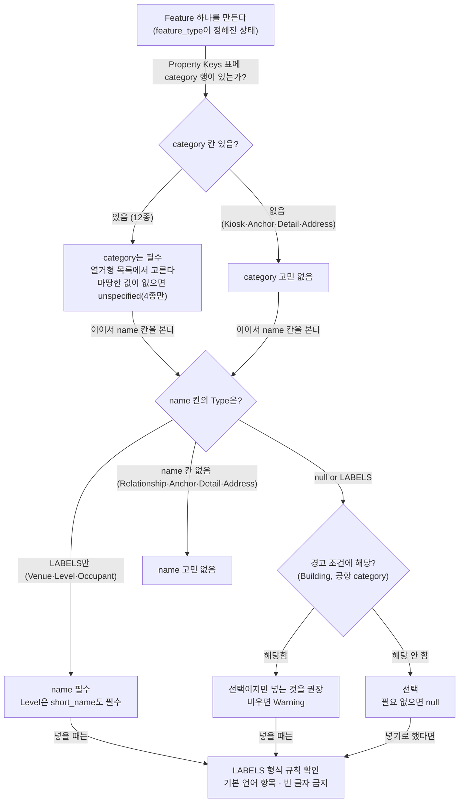

# 19) name·category 필수 입력 여부 — Feature Type 16종 한눈에 보기

## 요약

IMDF 데이터를 만들 때 가장 자주 생기는 질문은 "이 Feature에 이름(`name`)과 분류(`category`)를 꼭 넣어야 하는가"다. 공식 스펙(OGC IMDF 1.0.0)의 각 Feature 페이지 속성 표와 검증 규칙(Validations)을 모두 대조한 결론은 다음과 같다.

- **category는 칸이 있으면 무조건 필수다.** 16종 중 12종이 category 칸을 갖고, 12종 모두 비워 둘 수 없다.
- **name은 대부분 선택이다.** 반드시 넣어야 하는 것은 Venue, Level, Occupant 3종뿐이다. Level은 `short_name`(짧은 층 이름)도 필수다.
- **선택이어도 경고가 나는 경우가 있다.** Building은 name을 비우면 경고가 나고, 공항 탑승구·수하물 수취대 같은 일부 category의 Amenity·Fixture도 name이 없으면 경고가 난다.
- **둘 다 없는 Feature도 있다.** Kiosk는 name만, Relationship은 category만 있고, Anchor·Detail·Address에는 둘 다 없다.

---

## 1. 먼저 알아 둘 낱말

| 낱말 | 쉬운 뜻 | 예시 |
| --- | --- | --- |
| Feature | 지도 데이터 한 덩어리. 방 하나, 문 하나, 층 하나가 각각 Feature다 | 회의실 하나 = Unit Feature 하나 |
| Feature Type | Feature의 종류. IMDF에는 16종이 있다([[Feature Type]]) | `unit`, `opening`, `level` |
| Property Keys 표 | 스펙의 각 Feature 페이지에 있는 "이 Feature가 가질 수 있는 속성 칸 목록" 표. 칸 이름, 값의 형식(Type), 설명이 적혀 있다 | Unit 페이지의 `category`, `name`, `level_id` 행 |
| `null` | "값 없음"을 뜻하는 JSON의 특별한 값. 칸은 있지만 비어 있다는 표시다 | `"name": null` |
| `null or LABELS` | 표의 Type 칸 표기. "비워 둬도 되고(null), 넣는다면 LABELS 형식"이라는 뜻이다. `null or`가 없이 `LABELS`만 있으면 비울 수 없다 | Unit의 name은 `null or LABELS` → 선택 |
| [[LABELS]] | 이름을 담는 형식. 언어 코드를 열쇠로, 이름 글자를 값으로 짝지은 JSON 객체다 | `{"ko": "대회의실", "en": "Main Hall"}` |
| 열거형 | 미리 정해 둔 값 목록. category는 이 목록 안에서만 고를 수 있다 | UNIT-CATEGORY의 `room`, `office`, `stairs` |
| Validations | 스펙이 정해 둔 자동 검사 규칙 목록. 데이터가 규칙을 어기면 검사기가 알려 준다 | `UnitMustHaveCategory` |
| Violation | 검사 결과 중 무거운 등급. "규칙 위반"이라 데이터가 유효하지 않다 | category가 없는 Unit |
| Warning | 검사 결과 중 가벼운 등급. "확인해 보라"는 경고이고 위반은 아니다 | 이름 없는 Building |

**필수 여부를 판단하는 기준은 두 가지다.** 첫째, Property Keys 표의 Type 칸에 `null or`가 붙었는가. 둘째, Validations에 `...MustHaveName`이나 `...MustHaveCategory` 같은 검사가 있는가. 이 문서는 두 근거를 함께 적는다.

---

## 2. 한눈에 보는 표

### 2-1. name과 category의 필수 여부 (16종 전체)

| Feature Type | category 칸 | category 필수? | name 칸 | name 필수? | 비고 |
| --- | --- | --- | --- | --- | --- |
| **Venue** (장소 전체) | VENUE-CATEGORY | **필수** — Violation | `LABELS` | **필수** — Violation | `alt_name`은 선택 |
| **Building** (건물) | BUILDING-CATEGORY | **필수** — Violation | `null or LABELS` | 선택, 비우면 **Warning** | 유일하게 "선택인데 비우면 경고"인 name |
| **Footprint** (건물 바닥 윤곽) | `aerial`·`ground`·`subterranean` | **필수** — 표 기준 | `null or LABELS` | 선택 | name은 지도에 그리지 않는 참고 정보로 취급. `alt_name` 없음 |
| **Level** (층) | LEVEL-CATEGORY | **필수** — Violation | `LABELS` | **필수** — Violation | `short_name`도 필수(Violation). `alt_name` 없음 |
| **Unit** (방·복도 등 공간) | UNIT-CATEGORY | **필수** — Violation | `null or LABELS` | 선택 | |
| **Section** (주제 구역) | SECTION-CATEGORY | **필수** — Violation | `null or LABELS` | 선택 | |
| **Opening** (출입구) | OPENING-CATEGORY | **필수** — Violation | `null or LABELS` | 선택 | |
| **Geofence** (가상 경계) | GEOFENCE-CATEGORY | **필수** — Violation | `null or LABELS` | 선택 | |
| **Amenity** (편의시설 점) | AMENITY-CATEGORY | **필수** — Violation | `null or LABELS` | 선택 | 일부 category는 name 없으면 Warning(2-2절) |
| **Fixture** (가구·설비) | FIXTURE-CATEGORY | **필수** — Violation | `null or LABELS` | 선택 | `baggagecarousel`은 name 없으면 Warning(2-2절) |
| **Occupant** (입주 업체) | OCCUPANT-CATEGORY | **필수** — Violation | `LABELS` | **필수** — Violation | name은 브랜드명. `alt_name` 없음 |
| **Relationship** (연결 관계) | RELATIONSHIP-CATEGORY | **필수** — 표 기준 | 없음 | — | |
| **Kiosk** (키오스크) | 없음 | — | `null or LABELS` | 선택 | |
| Anchor (위치 기준점) | 없음 | — | 없음 | — | |
| Detail (자유 선) | 없음 | — | 없음 | — | |
| Address (주소) | 없음 | — | 없음 | — | 주소 글자는 `address`·`locality` 등 별도 칸 |

표의 "Violation"은 Validations에 `<Feature>MustHaveCategory` 또는 `<Feature>MustHaveName` 검사가 있다는 뜻이다. **"표 기준"은 검사 규칙은 없지만 Property Keys 표의 Type 칸에 `null or`가 없어 비울 수 없다는 뜻이다.** Footprint와 Relationship에는 `MustHaveCategory` 검사가 없고, 값이 목록 안에 있는지 보는 `CategoryMustBeValid`(Violation)만 있다.

### 2-2. 선택이지만 비우면 경고가 나는 name

| Feature | 조건 | 검사 규칙 (모두 Warning) |
| --- | --- | --- |
| Building | 항상 | `BuildingHasNoName` |
| Amenity | category가 `boardinggate.aircraft`(비행기 탑승구) | `AircraftBoardingGateAmenityShouldHaveName` |
| Amenity | category가 `boardinggate.bus`(버스 탑승구) | `BusBoardingGateAmenityShouldHaveName` |
| Amenity | category가 `boardinggate.train`(열차 탑승구) | `TrainBoardingGateAmenityShouldHaveName` |
| Amenity | category가 `arrivalgate`(도착 게이트) | `ArrivalGateAmenityShouldHaveName` |
| Amenity | category가 `baggagecarousel`(수하물 수취대) | `BaggageCarouselAmenityShouldHaveName` |
| Fixture | category가 `baggagecarousel`이고, display_point가 있으며, 안에 같은 종류 Amenity가 없을 때 | `BaggageCarouselFixtureShouldHaveName` |

경고 대상은 모두 공항·교통 시설이다. 탑승구 번호(예: "23번 게이트")처럼 **이름 자체가 길 찾기 정보인 경우**에 이름을 요구한다고 보면 이해하기 쉽다. 이 해석은 규칙 목록을 보고 정리한 것이고, 스펙이 이유를 직접 설명하지는 않는다.

### 2-3. name 말고 비슷한 이름 칸

| 칸 | 가진 Feature | 필수? | 뜻 |
| --- | --- | --- | --- |
| `alt_name` | Venue, Building, Unit, Section, Opening, Geofence, Amenity, Fixture, Kiosk | 모두 선택(`null or LABELS`) | 다른 이름, 별칭. 예: 정식 명칭 "중앙도서관"의 별칭 "중도" |
| `short_name` | Level | **필수**(Violation) | 짧은 층 이름. 엘리베이터 버튼 같은 데 쓰는 표기. 예: name "1층", short_name "1F" |

Level, Footprint, Occupant에는 `alt_name` 칸이 없다.

---

## 3. 왜 category는 필수이고 name은 대부분 선택인가

스펙이 이유를 한 문장으로 적어 두지는 않았다. 다만 각 칸의 역할을 보면 차이를 이해할 수 있다.

- **category는 지도 앱이 "이것이 무엇인가"를 판단하는 유일한 칸이다.** 화장실 아이콘을 띄울지, 계단으로 길을 낼지, 출입 불가 구역으로 칠할지를 category로 정한다. 비어 있으면 앱이 그 Feature를 어떻게 다룰지 알 수 없다.
- **name은 사람이 읽는 글씨다.** 복도·계단·화장실처럼 category만으로 충분한 공간은 이름이 없어도 지도가 동작한다. 그래서 비워 둘 수 있게 했다.
- **반대로 Venue·Level·Occupant는 이름이 없으면 사용자가 고를 수 없다.** 장소 목록에서 Venue를 찾고, 층 선택 버튼으로 Level을 고르고, 매장 목록에서 Occupant를 찾을 때 모두 이름을 본다. 이 세 종류만 name이 필수인 것이 이 역할과 맞는다.

분류할 값이 마땅치 않을 때는 `unspecified`를 쓸 수 있다. 이 값은 UNIT-CATEGORY, LEVEL-CATEGORY, BUILDING-CATEGORY, AMENITY-CATEGORY에만 있다([[08) IMDF Feature Type·카테고리 전체 레퍼런스]]). 칸을 비우는 것보다는 낫지만, 많이 쓰면 지도 품질이 떨어진다.

---

## 4. name을 넣을 때 지켜야 할 형식

name은 선택이더라도, 넣는 순간 아래 규칙을 지켜야 한다. 근거는 Reference의 LABELS 정의와 Validations다.

| 규칙 | 근거와 등급 | 틀린 예 → 맞는 예 |
| --- | --- | --- |
| 값은 글자 하나가 아니라 언어 코드가 붙은 객체 | LABELS 정의(MUST) | `"name": "대회의실"` → `"name": {"ko": "대회의실"}` |
| 언어 코드는 유효해야 한다 | LABELS 정의(MUST) | `{"korean": "..."}` → `{"ko": "..."}` |
| 같은 언어 코드를 두 번 쓰지 않는다 | LABELS 정의(MUST NOT) | |
| 기본 언어 항목이 반드시 있어야 한다 | LABELS 정의(MUST). 기본 언어는 manifest의 `language` | manifest가 `"ko"`인데 `{"en": "Hall"}`만 있음 → `{"ko": "홀", "en": "Hall"}` |
| 빈 글자 금지 | `LabelMustNotBeBlank`, Violation | `{"ko": ""}` → `"name": null` |
| `alt_name`만 있고 `name`이 없으면 안 된다 | `HasOnlyAltName`, Warning | |
| `alt_name`의 언어는 `name`에도 있어야 한다 | `AltNameLangTagHasNoCorrespondingNameLangTag`, Warning | name은 `ko`만, alt_name은 `en`만 → name에도 `en` 추가 |
| Amenity의 name을 category와 똑같이 쓰지 않는다 | `AmenityNameAndCategoryAreSame`, Warning | category `restroom`, name `{"en": "restroom"}` → name을 비우거나 고유한 이름으로 |
| 같은 건물의 층 이름은 서로 달라야 한다 | `LevelNamesInBuildingShouldBeDistinct`·`LevelShortNamesInBuildingShouldBeDistinct`, Warning | 두 층 모두 short_name `"1F"` |
| Unit의 name에 "301호" 같은 호수를 넣지 않는다 | Unit 규칙(SHOULD NOT), [[16) Unit 레이어 태깅 규칙 — 무엇을 한 Unit으로 자르고 어떤 category를 붙이는가]] | 호수는 Address의 `unit` 칸으로 |

**이름이 없을 때는 칸을 지우지 말고 `null`로 적는 것이 안전하다.** 스펙 예제가 모두 `"alt_name": null`처럼 적는다. 다만 "칸을 생략하면 안 된다"는 문장은 찾지 못했다. `확인 필요`

---

## 5. GeoJSON 예시 — 필수 칸만 채운 Level과 Unit

필수 칸만 채우고 선택 칸은 `null`로 둔 최소 예시다. 좌표와 id는 설명용 값이다.

```json
[
  {
    "id": "a1b2c3d4-0000-4000-8000-000000000001",
    "type": "Feature",
    "feature_type": "level",
    "geometry": { "type": "Polygon", "coordinates": [[[129.0, 36.0], [129.001, 36.0], [129.001, 36.001], [129.0, 36.001], [129.0, 36.0]]] },
    "properties": {
      "category": "unspecified",
      "restriction": null,
      "ordinal": 0,
      "outdoor": false,
      "name": { "ko": "1층", "en": "Floor 1" },
      "short_name": { "ko": "1F", "en": "1F" },
      "display_point": null,
      "address_id": null,
      "building_ids": null
    }
  },
  {
    "id": "a1b2c3d4-0000-4000-8000-000000000002",
    "type": "Feature",
    "feature_type": "unit",
    "geometry": { "type": "Polygon", "coordinates": [[[129.0, 36.0], [129.0005, 36.0], [129.0005, 36.0005], [129.0, 36.0005], [129.0, 36.0]]] },
    "properties": {
      "category": "walkway",
      "restriction": null,
      "accessibility": null,
      "name": null,
      "alt_name": null,
      "display_point": null,
      "level_id": "a1b2c3d4-0000-4000-8000-000000000001"
    }
  }
]
```

```json
[
// 대괄호는 여러 Feature를 순서대로 담는 목록이다. 실제 파일에서는 level.geojson과 unit.geojson에 따로 들어가지만, 비교하려고 한 목록에 모았다.
  {
// 중괄호 하나가 Feature 하나다. 첫 번째는 층(Level)이다.
    "id": "a1b2c3d4-0000-4000-8000-000000000001",
// 이 층의 고유 번호(UUID). 아래 Unit이 이 번호로 이 층을 가리킨다.
    "type": "Feature",
// GeoJSON 형식에서 "이것은 지도 요소 하나"라고 알리는 고정 표기다.
    "feature_type": "level",
// IMDF에서 이 요소가 Level(층)이라는 뜻이다.
    "geometry": { "type": "Polygon", "coordinates": [[[129.0, 36.0], [129.001, 36.0], [129.001, 36.001], [129.0, 36.001], [129.0, 36.0]]] },
// 층 바닥의 모양. 다각형(Polygon)이고, 꼭짓점을 [경도, 위도]로 적는다. 첫 점과 끝 점이 같아야 닫힌다.
    "properties": {
// 이 층의 속성 칸들이 시작된다.
      "category": "unspecified",
// 층의 용도 분류. 필수 칸이라 비울 수 없다. 특별한 용도가 없어서 "분류 안 됨"을 뜻하는 unspecified를 넣었다.
      "restriction": null,
// 출입 제한. 선택 칸이라 null(값 없음)로 둔다.
      "ordinal": 0,
// 층 순서 번호. 지상 출입층은 0이다.
      "outdoor": false,
// 실외 층인지 여부. 실내라서 false다.
      "name": { "ko": "1층", "en": "Floor 1" },
// 층 이름. Level에서는 필수 칸이다. 언어 코드(ko·en)를 열쇠로 이름을 적는 LABELS 형식이다.
      "short_name": { "ko": "1F", "en": "1F" },
// 짧은 층 이름. 이것도 Level에서는 필수다. 층 선택 버튼 같은 좁은 자리에 쓴다.
      "display_point": null,
// 이름표를 놓을 위치. 선택 칸이라 null로 둔다.
      "address_id": null,
// 주소 연결. 선택 칸이라 null로 둔다.
      "building_ids": null
// 이 층이 속한 건물 목록. 선택 칸이라 null로 둔다.
    }
// 층의 속성 칸이 끝난다.
  },
// 첫 번째 Feature(층)가 끝난다.
  {
// 두 번째 Feature는 공간(Unit)이다.
    "id": "a1b2c3d4-0000-4000-8000-000000000002",
// 이 Unit의 고유 번호다.
    "type": "Feature",
// GeoJSON 고정 표기다.
    "feature_type": "unit",
// 이 요소가 Unit(공간 조각)이라는 뜻이다.
    "geometry": { "type": "Polygon", "coordinates": [[[129.0, 36.0], [129.0005, 36.0], [129.0005, 36.0005], [129.0, 36.0005], [129.0, 36.0]]] },
// 이 공간의 바닥 모양이다. 층 안에 들어가야 한다.
    "properties": {
// 이 Unit의 속성 칸들이 시작된다.
      "category": "walkway",
// 공간의 용도 분류. Unit에서도 필수다. 복도라서 walkway를 넣었다.
      "restriction": null,
// 출입 제한 없음.
      "accessibility": null,
// 접근성 정보 없음.
      "name": null,
// 이름. Unit에서는 선택이라 복도처럼 이름이 필요 없으면 null로 둔다. 빈 글자("")를 넣으면 검사에 걸리니 null을 쓴다.
      "alt_name": null,
// 별칭. 선택이라 null로 둔다.
      "display_point": null,
// 이름표 위치. 이름이 없으니 비워 둔다.
      "level_id": "a1b2c3d4-0000-4000-8000-000000000001"
// 이 Unit이 속한 층의 번호. 위 Level의 id와 같다.
    }
// Unit의 속성 칸이 끝난다.
  }
// 두 번째 Feature(Unit)가 끝난다.
]
// 목록이 끝난다.
```



- 맨 위 노드는 어떤 Feature를 만들지 정한 상태다. 첫 화살표는 그 Feature 페이지의 Property Keys 표에서 category 행을 찾는 동작이다.
- "category는 필수" 노드는 칸이 있는 12종 모두에 해당한다. 그 아래 화살표는 category를 정한 뒤 name 칸으로 넘어가는 순서를 뜻한다.
- "name 칸의 Type은?" 노드에서 세 갈래로 나뉜다. `LABELS`만 있으면 필수, `null or LABELS`면 선택, 행이 없으면 고민할 필요가 없다.
- 마지막 "LABELS 형식 규칙 확인" 노드로 가는 화살표는 "name을 넣는 순간" 4절 규칙이 적용된다는 뜻이다.

---

## 6. IMDFrnt에서의 적용

| 항목 | 스펙 | IMDFrnt 현황 (2026-10-19 확인) |
| --- | --- | --- |
| 필수 칸 표시 | category 12종, name 3종(+short_name) | `Model/PropertySchema.swift`에 필수 여부 표시가 없다(`required`·`필수` 검색 결과는 Geofence 주석 한 줄뿐). 입력 화면이 필수 칸을 구분해 보여 주는지는 `확인 필요` |
| 내보내기 전 검사 | `MustHaveCategory`·`MustHaveName` Violation | 내보내기가 category·name이 빈 Feature를 막거나 경고하는지 `확인 필요` |

---

## 관련 링크

- [[src23. IMDF name·category 필수 여부 원문 조사 — 16종 Property Keys·Validations·Archives]] — 이 문서의 원문 근거(표 행·검증 규칙 전수)
- [[08) IMDF Feature Type·카테고리 전체 레퍼런스]] — 16종의 geometry·속성과 카테고리 열거형 전체 값
- [[05) 라벨에 관하여]] — name·display_point가 지도 라벨이 되는 방식
- [[LABELS]] — name·alt_name·short_name의 값 형식
- [[Level]] — name·short_name이 둘 다 필수인 Feature
- [[16) Unit 레이어 태깅 규칙 — 무엇을 한 Unit으로 자르고 어떤 category를 붙이는가]] — Unit name의 형식 규칙(호수 금지 등)
- [[17) Section 레이어 태깅 규칙 — Unit 위에 주제 구역을 어디까지 긋고 무엇을 붙이는가]]
- [[18) Amenity 레이어 태깅 규칙 — 편의시설을 점 하나로 어디에 찍고 무엇을 연결하는가]] — 이름이 있어야 하는 Amenity category

## 미해결 질문

- 값이 `null`인 선택 칸을 아예 생략해도 검사기를 통과하는가. 스펙 예제는 모두 키를 남기고 `null`로 적는다.
- Kiosk의 `HasOnlyAltName`이 Validations에 Violation과 Warning으로 두 번 실려 있다. 실제 검사기는 어느 등급을 쓰는가.
- Address에는 LABELS 칸이 없는데 `LabelMustNotBeBlank`가 붙어 있는 이유는 무엇인가.
- Footprint·Relationship에 `MustHaveCategory` 검사가 없는 것이 의도인가. 표상으로는 둘 다 category를 비울 수 없다.
- IMDFrnt의 속성 입력 화면과 내보내기가 필수 칸을 검사하는가(6절).
